# CodeArena architecture

CodeArena is a coding practice and fest platform built as a set of Spring Boot services behind one gateway.
User code never runs inside a service: it is queued and executed by a separate judge in throw-away, gVisor-isolated
containers. This document describes the local edition (everything on one Linux machine) and how it maps to AWS.

Diagrams are Mermaid; they render on GitHub, GitLab and in VS Code (Markdown Preview Mermaid Support extension).

## 0. Block diagram (one-page overview)

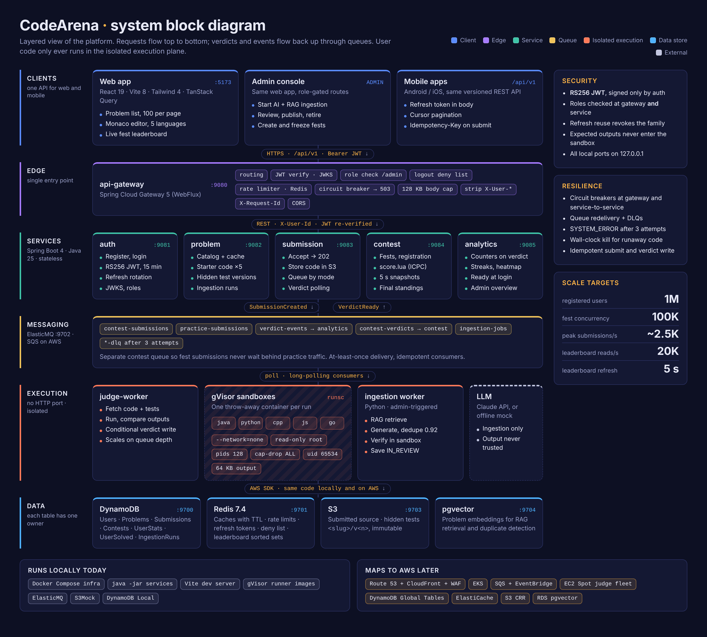

The picture is a screenshot of [`architecture-block.html`](architecture-block.html), a self-contained HTML page:
open it in any browser for a sharp, zoomable version, or edit it and re-capture the PNG. Read it top to bottom:
requests go clients → gateway → services → queues → execution, and verdicts come back up the queues. Every layer
reads and writes the data layer at the bottom; only the execution plane ever runs user or LLM-written code.

## 0b. Data flow, end to end

Source: [`data-flow.html`](data-flow.html). It follows the data through seven stages (create a problem, sign in,
browse, submit, judge, fan out, see results), labels every arrow with the data it carries, and marks which data
store (D1 to D10) each step reads or writes, with a data dictionary at the bottom.

## 1. Context: who uses it and what it talks to

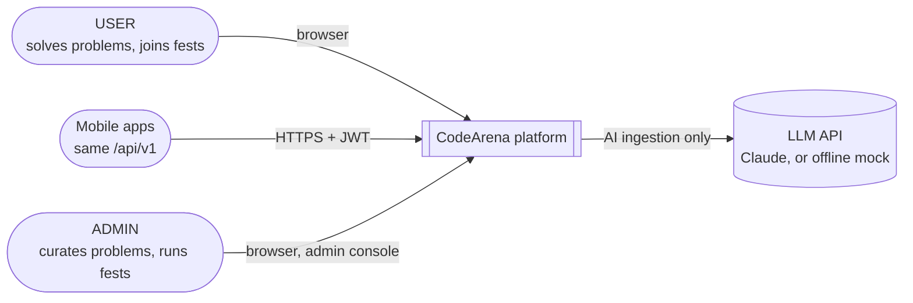

| Role | Can do |
| --- | --- |
| USER | browse problems, run and submit code in Java, Python, C++, JavaScript or Go, register for fests, see own progress |
| ADMIN | everything a user can, plus author, review, publish and retire problems, start AI + RAG ingestion runs, create and freeze fests, view platform analytics, grant admin |

## 2. Components

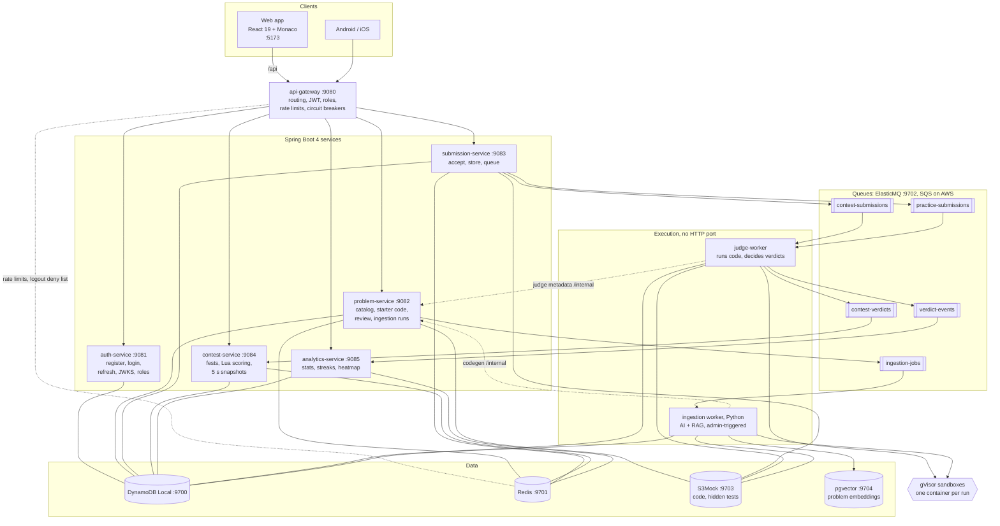

| Component | Owns | Key idea |
| --- | --- | --- |
| api-gateway | routes, edge security | the only entry point; services also re-check roles |
| auth-service | users, roles, tokens | the only holder of the signing key; everyone else verifies with JWKS |
| problem-service | problems, hidden-test versions, ingestion runs | one language-neutral signature generates starter code and harnesses for 5 languages |
| submission-service | submissions | never runs code; returns 202 in milliseconds |
| judge-worker | verdicts | stateless, horizontally scalable, idempotent |
| contest-service | fests, leaderboards | one precomputed snapshot every 5 s, whatever the number of viewers |
| analytics-service | per-user stats | pre-aggregated counters, ready at next login |
| ingestion worker | generated problems (in review) | LLM output is verified by executing it, never trusted |

## 3. Request path through the gateway

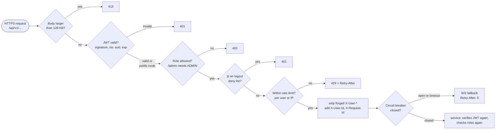

| Route | Limit |
| --- | --- |
| `POST /auth/login`, `/auth/register` | 1/s per IP, burst 10 |
| `POST /submissions` | 1/s per user, burst 5 |
| everything else | no gateway limit (services are cached and cheap) |

## 4. Authentication and token refresh

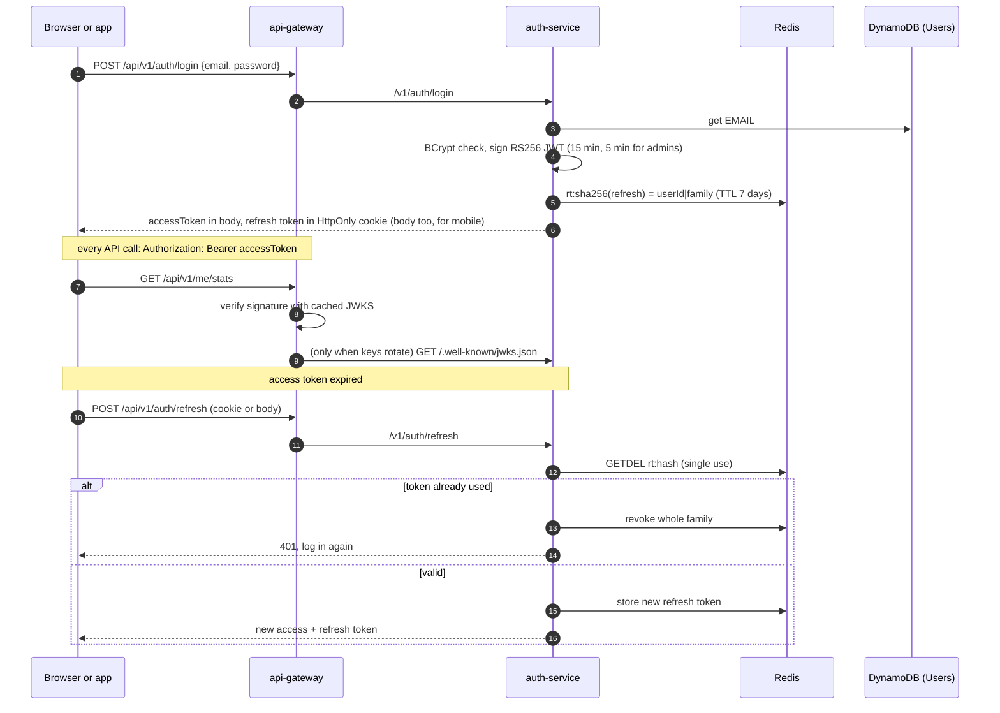

## 5. Submitting code: from click to verdict

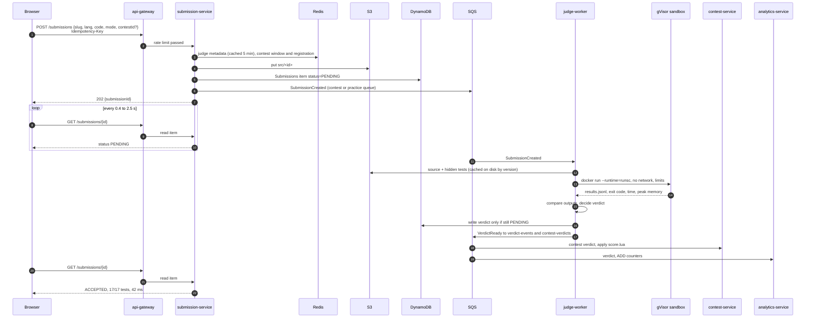

Two queues keep fests fast: contest submissions never wait behind practice traffic.
**Run** mode judges only the visible examples (plus an optional custom input), is not counted, and expires after a day.

## 6. Inside the sandbox

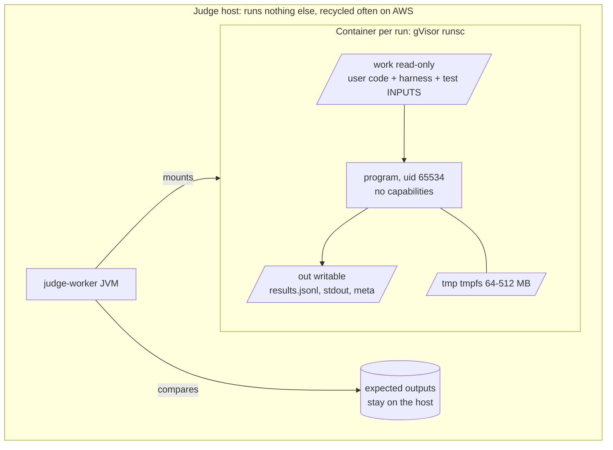

| Threat | Control | Verdict |
| --- | --- | --- |
| infinite loop | `timeout -s KILL` inside, wall-clock kill outside | TIME_LIMIT_EXCEEDED |
| memory bomb | `--memory` = `--memory-swap` | MEMORY_LIMIT_EXCEEDED |
| fork bomb | `--pids-limit=128` | RUNTIME_ERROR |
| network, cloud metadata | `--network=none` | RUNTIME_ERROR |
| writing files, filling disk | `--read-only`, small tmpfs, `fsize` ulimit | RUNTIME_ERROR |
| output flood | 64 KB cap | OUTPUT_LIMIT_EXCEEDED |
| reading the answers | expected outputs never enter the container | WRONG_ANSWER |
| kernel exploit, escape | gVisor user-space kernel, `no-new-privileges`, non-root | contained |
| judge crash, poison message | SQS redelivery, conditional verdict write, SYSTEM_ERROR after 3 attempts, DLQ | queue keeps flowing |

## 7. Live fest leaderboard

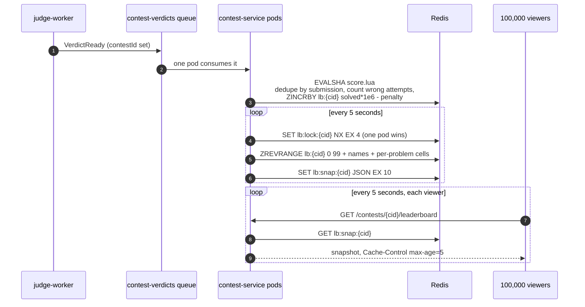

Score = solved × 1,000,000 − penalty minutes (ICPC: minutes to accept + 20 per wrong attempt before it).
All keys of one contest share the `{cid}` hash tag, so they sit on one Redis Cluster slot; TTLs remove them a week
after the fest. Reading the board costs one Redis GET, so it scales with a CDN, not with the database.

## 8. Admin-only AI + RAG ingestion

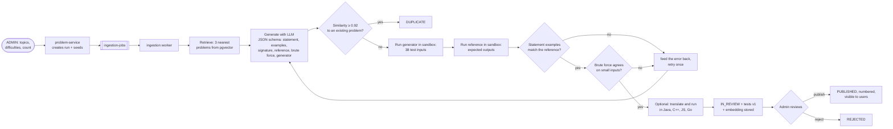

The model writes inputs, never expected outputs; outputs come from executing the reference solution. All
LLM-written code runs in the same sandbox as user code. Problems are original; nothing is scraped.

## 9. Problem lifecycle

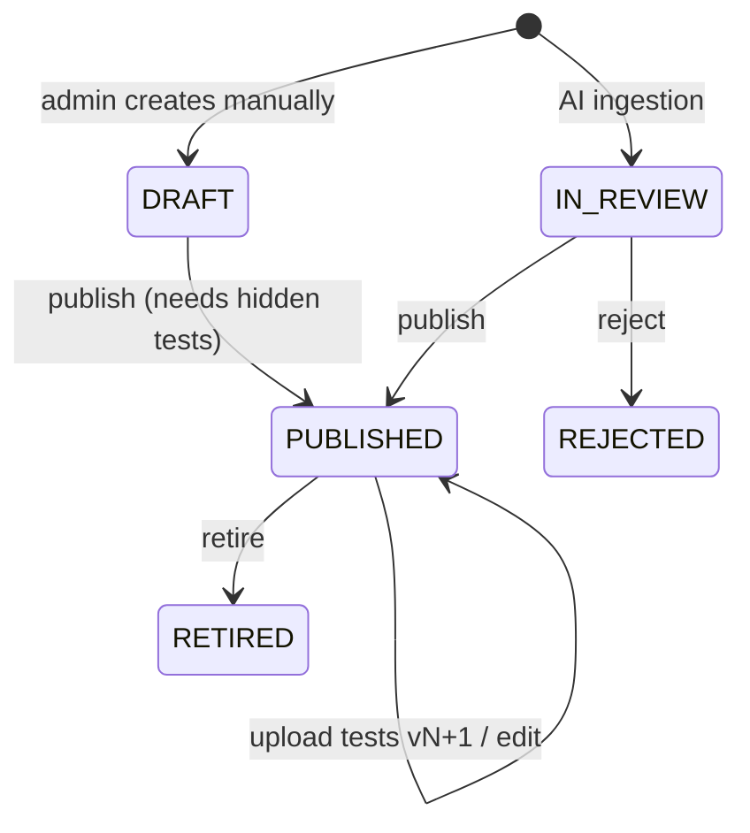

Publishing takes the next problem number from an atomic counter and bumps the list cache version, so every
user sees the new list at once.

## 10. Data ownership

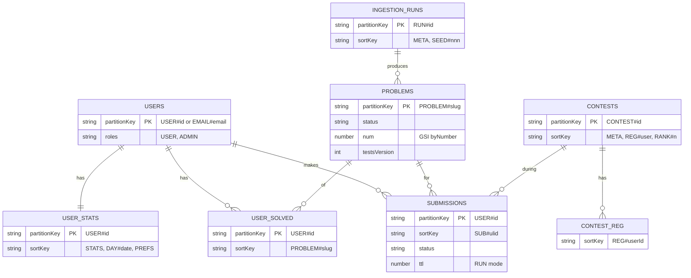

| Store | Holds | Owner |
| --- | --- | --- |
| DynamoDB `Users`, `AuditLog` | accounts, roles, admin actions | auth-service (+ problem-service audit) |
| DynamoDB `Problems` | problem docs, counters, acceptance | problem-service (analytics adds counters) |
| DynamoDB `Submissions` | every run and verdict | submission-service, judge-worker |
| DynamoDB `Contests` | fests, registrations, final standings | contest-service |
| DynamoDB `UserStats`, `UserSolved` | progress, heatmap, preferences | analytics-service |
| DynamoDB `IngestionRuns` | AI run progress | problem-service, ingestion worker |
| S3 `codearena-tests` | `<slug>/v<n>/cases.jsonl`, immutable | problem-service, ingestion |
| S3 `codearena-submissions` | `src/<submissionId>` | submission-service |
| Redis | rate limits, refresh tokens, deny list, caches, leaderboards, contest gate | gateway, auth, problem, submission, contest, analytics |
| pgvector | problem embeddings for RAG and dedupe | ingestion worker |

## 11. Local deployment (this guide)

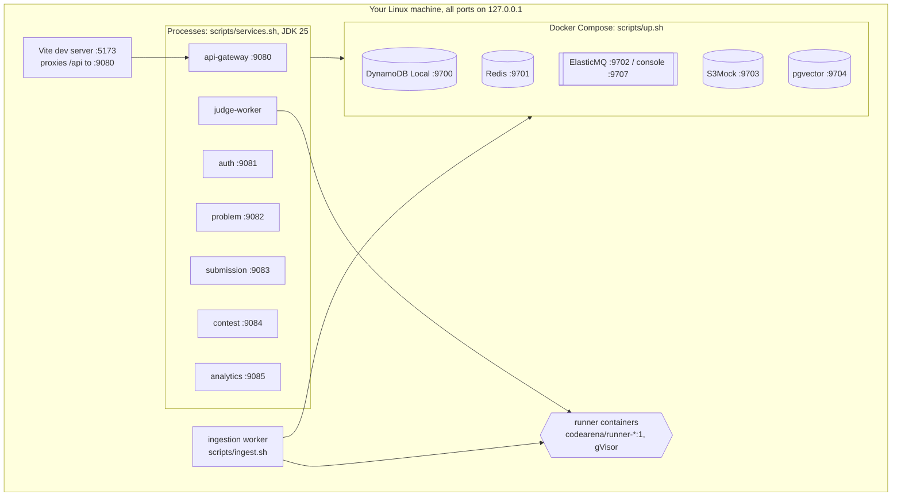

## 12. On AWS (after local testing)

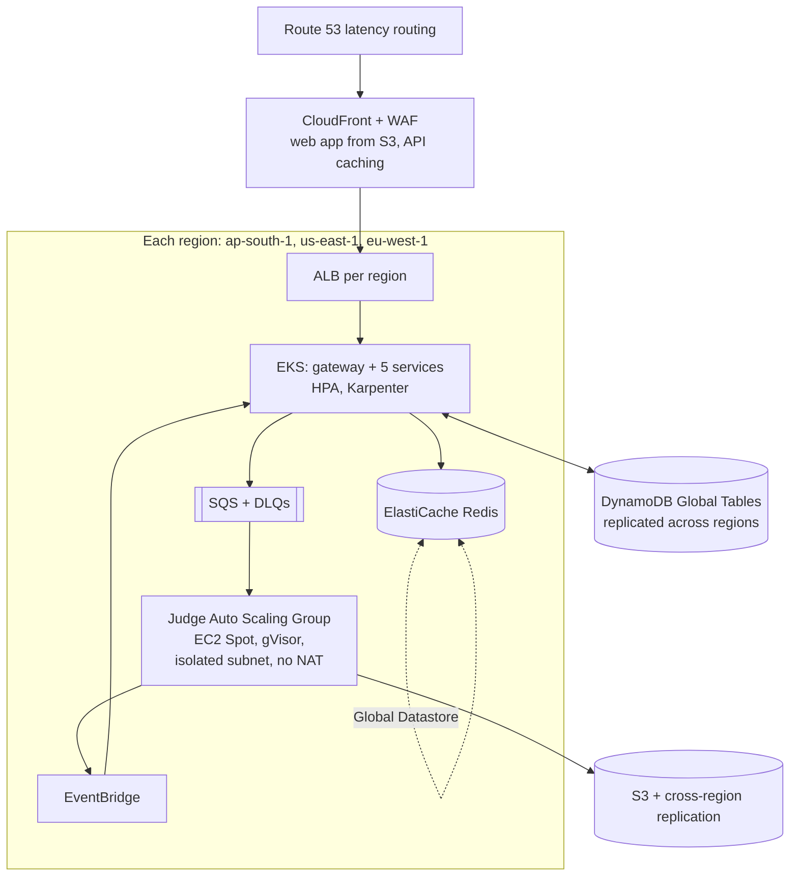

| Local | AWS |
| --- | --- |
| DynamoDB Local | DynamoDB Global Tables (active-active, multi-region) |
| Redis container | ElastiCache (cluster mode) + Global Datastore |
| ElasticMQ, two verdict queues | SQS + EventBridge rules |
| S3Mock | S3 + cross-region replication |
| pgvector container | RDS PostgreSQL with pgvector |
| `java -jar` processes | EKS Deployments behind an ALB |
| judge on your machine | dedicated EC2 Auto Scaling Group on Spot, scaled on queue depth |
| `.local/jwt-private.pem` | Secrets Manager |

Only endpoints and credentials change between the two: the services use the standard AWS SDK throughout.

## 13. Capacity design

| Load | Estimate | Answer in the design |
| --- | --- | --- |
| 1 million users, ~20K concurrent normally | mostly reads | problem list served from one Redis entry; stateless JWT |
| 100K fest users submitting every ~2 min | ~830 submissions/s, bursts ~2,500/s | async queue; contest queue separate; judge fleet scales on queue depth |
| judge CPU at peak | ~415 busy CPUs | Spot instances, pre-warmed before the fest |
| leaderboard polling | 100K / 5 s = 20,000 req/s | one snapshot per 5 s, cacheable; one Redis GET per read |
| login burst at fest start | ~330/s | per-IP rate limit, BCrypt on auth pods only |
