# CodeArena: build a LeetCode-style platform, step by step (local edition)

This guide builds the whole platform on your own Linux machine: no cloud account, no costs. Every chapter adds one
working piece and ends with a check you can run. The AWS deployment comes later, once everything here is tested.

## How to use this guide

Each chapter contains complete files. A file block is always introduced by a line like **File:** `path/to/File.java`.
You can type them in yourself (recommended for the parts you want to learn deeply) or let `extract_code.py` write them:

```bash
mkdir -p ~/Projects/codearena && cd ~/Projects/codearena
python3 /path/to/extract_code.py /path/to/codearena-guide/01-*.md            # dry run: lists the files
python3 /path/to/extract_code.py /path/to/codearena-guide/01-*.md --write    # writes them
python3 /path/to/extract_code.py /path/to/codearena-guide/*.md --write       # every chapter at once
```

Existing files are never overwritten unless you add `--force`. Code shown without a **File:** line is an
example or a command, never a file to create. The complete repository is also in `codearena-repo.zip`.

## What you are building

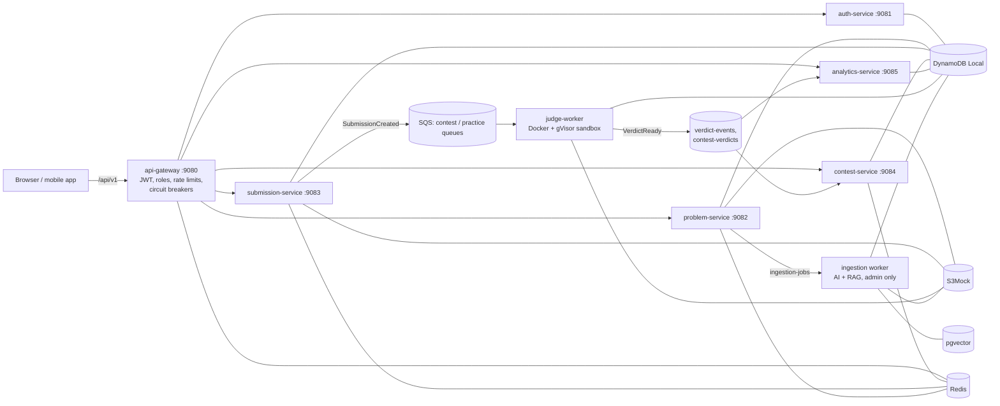

The full architecture, with 12 diagrams (components, gateway path, auth, submit-to-verdict, sandbox, leaderboard,
AI ingestion, data model, local and AWS deployment), is in its own file, `architecture.md`, shipped next to this
guide. Keep a copy in the repo so it travels with the code:

**File:** `docs/architecture.md`

````markdown
# CodeArena architecture

CodeArena is a coding practice and fest platform built as a set of Spring Boot services behind one gateway.
User code never runs inside a service: it is queued and executed by a separate judge in throw-away, gVisor-isolated
containers. This document describes the local edition (everything on one Linux machine) and how it maps to AWS.

Diagrams are Mermaid; they render on GitHub, GitLab and in VS Code (Markdown Preview Mermaid Support extension).

## 0. Block diagram (one-page overview)

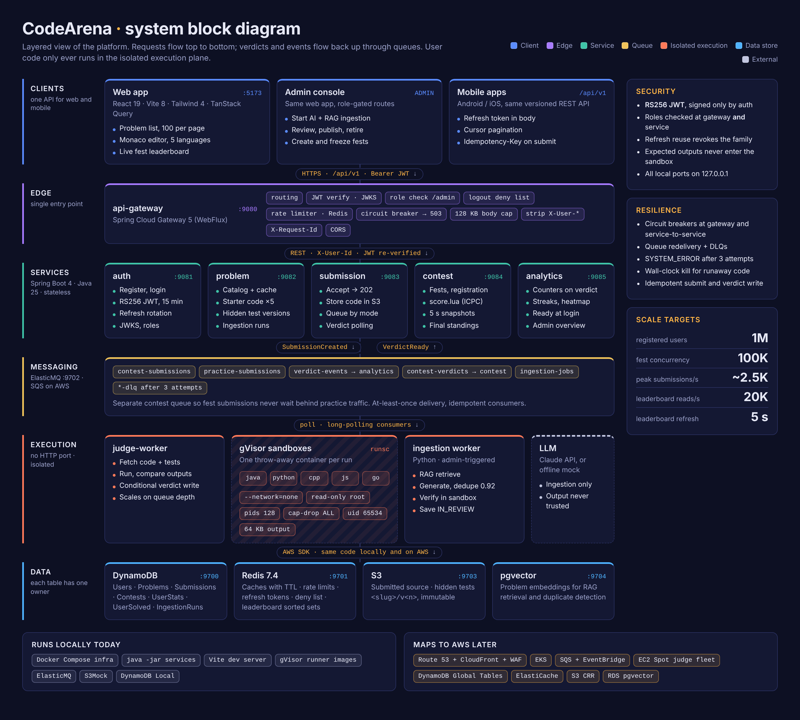

The picture is a screenshot of [`architecture-block.html`](architecture-block.html), a self-contained HTML page:
open it in any browser for a sharp, zoomable version, or edit it and re-capture the PNG. Read it top to bottom:
requests go clients → gateway → services → queues → execution, and verdicts come back up the queues. Every layer
reads and writes the data layer at the bottom; only the execution plane ever runs user or LLM-written code.

## 0b. Data flow, end to end

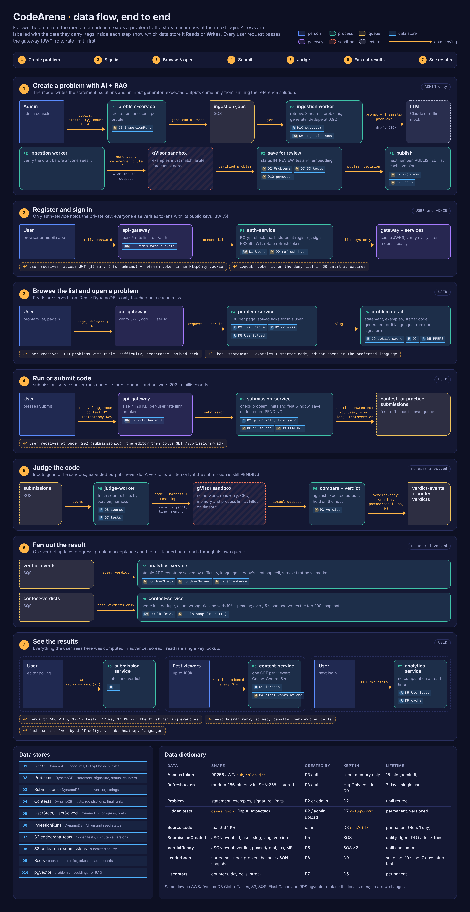

Source: [`data-flow.html`](data-flow.html). It follows the data through seven stages (create a problem, sign in,
browse, submit, judge, fan out, see results), labels every arrow with the data it carries, and marks which data
store (D1 to D10) each step reads or writes, with a data dictionary at the bottom.

## 1. Context: who uses it and what it talks to

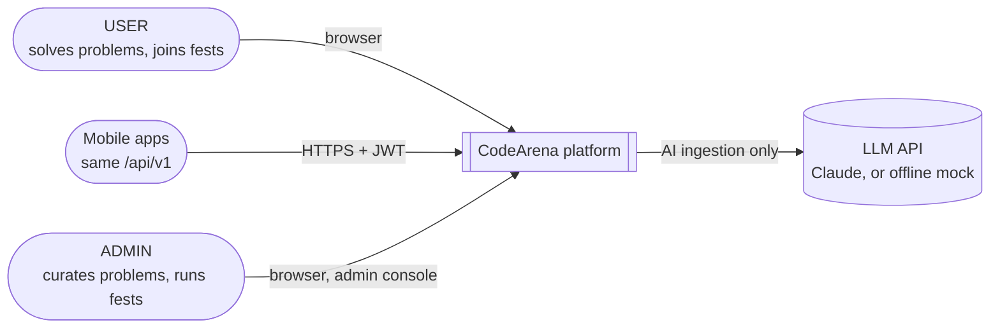

| Role | Can do |
| --- | --- |
| USER | browse problems, run and submit code in Java, Python, C++, JavaScript or Go, register for fests, see own progress |
| ADMIN | everything a user can, plus author, review, publish and retire problems, start AI + RAG ingestion runs, create and freeze fests, view platform analytics, grant admin |

## 2. Components

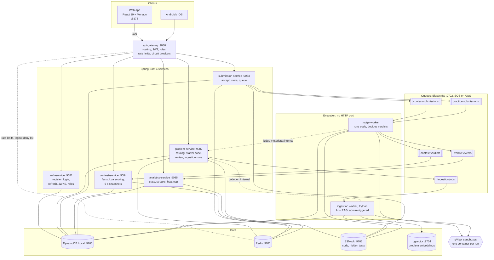

| Component | Owns | Key idea |
| --- | --- | --- |
| api-gateway | routes, edge security | the only entry point; services also re-check roles |
| auth-service | users, roles, tokens | the only holder of the signing key; everyone else verifies with JWKS |
| problem-service | problems, hidden-test versions, ingestion runs | one language-neutral signature generates starter code and harnesses for 5 languages |
| submission-service | submissions | never runs code; returns 202 in milliseconds |
| judge-worker | verdicts | stateless, horizontally scalable, idempotent |
| contest-service | fests, leaderboards | one precomputed snapshot every 5 s, whatever the number of viewers |
| analytics-service | per-user stats | pre-aggregated counters, ready at next login |
| ingestion worker | generated problems (in review) | LLM output is verified by executing it, never trusted |

## 3. Request path through the gateway


| Route | Limit |
| --- | --- |
| `POST /auth/login`, `/auth/register` | 1/s per IP, burst 10 |
| `POST /submissions` | 1/s per user, burst 5 |
| everything else | no gateway limit (services are cached and cheap) |

## 4. Authentication and token refresh

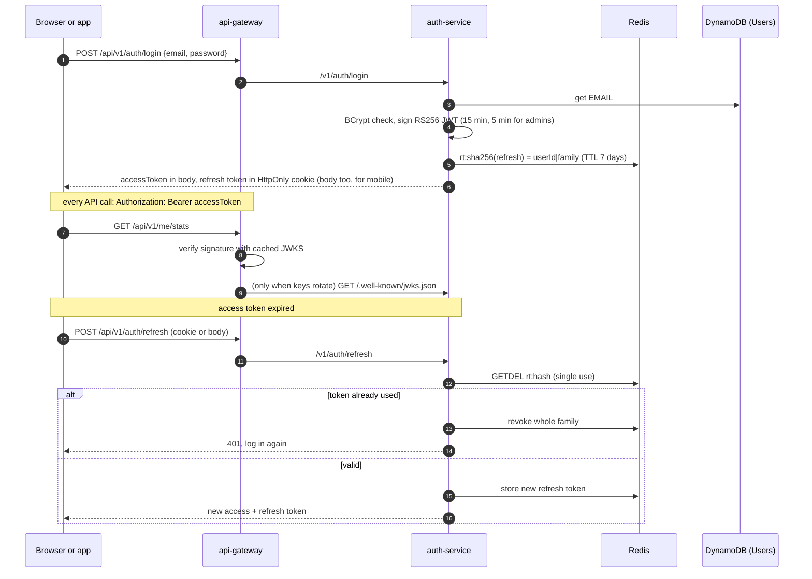

## 5. Submitting code: from click to verdict

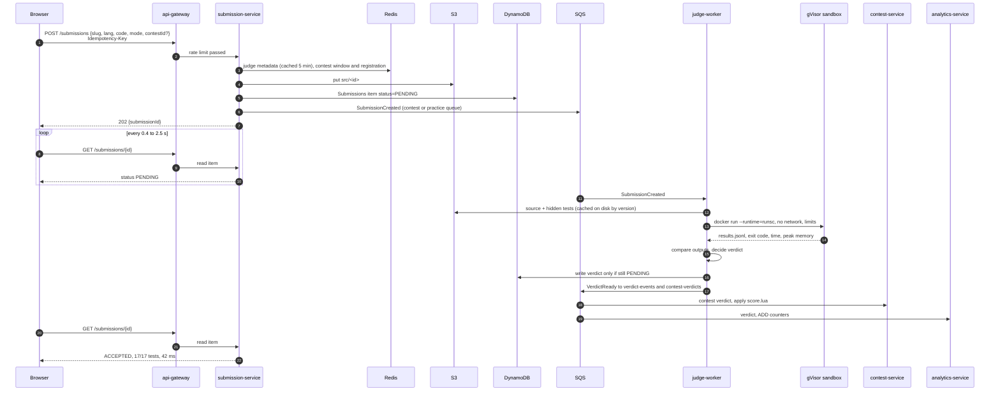

Two queues keep fests fast: contest submissions never wait behind practice traffic.
**Run** mode judges only the visible examples (plus an optional custom input), is not counted, and expires after a day.

## 6. Inside the sandbox

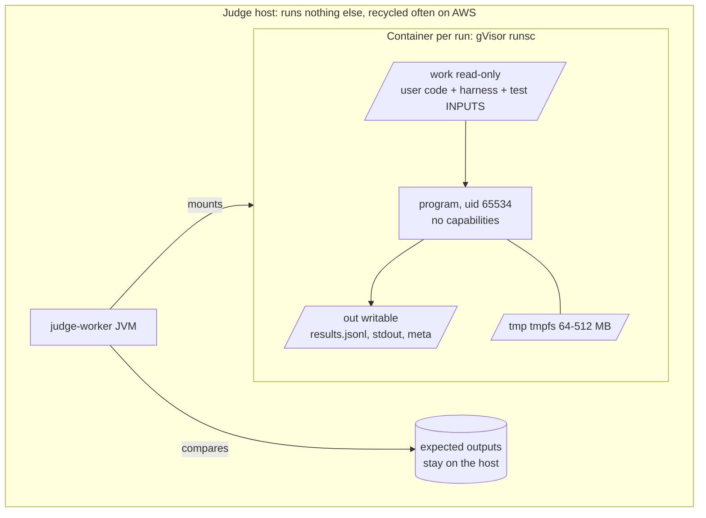

| Threat | Control | Verdict |
| --- | --- | --- |
| infinite loop | `timeout -s KILL` inside, wall-clock kill outside | TIME_LIMIT_EXCEEDED |
| memory bomb | `--memory` = `--memory-swap` | MEMORY_LIMIT_EXCEEDED |
| fork bomb | `--pids-limit=128` | RUNTIME_ERROR |
| network, cloud metadata | `--network=none` | RUNTIME_ERROR |
| writing files, filling disk | `--read-only`, small tmpfs, `fsize` ulimit | RUNTIME_ERROR |
| output flood | 64 KB cap | OUTPUT_LIMIT_EXCEEDED |
| reading the answers | expected outputs never enter the container | WRONG_ANSWER |
| kernel exploit, escape | gVisor user-space kernel, `no-new-privileges`, non-root | contained |
| judge crash, poison message | SQS redelivery, conditional verdict write, SYSTEM_ERROR after 3 attempts, DLQ | queue keeps flowing |

## 7. Live fest leaderboard

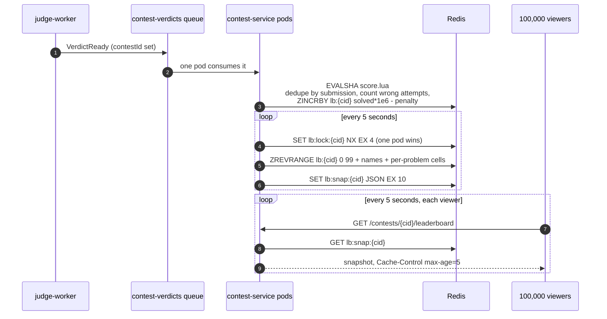

Score = solved × 1,000,000 − penalty minutes (ICPC: minutes to accept + 20 per wrong attempt before it).
All keys of one contest share the `{cid}` hash tag, so they sit on one Redis Cluster slot; TTLs remove them a week
after the fest. Reading the board costs one Redis GET, so it scales with a CDN, not with the database.

## 8. Admin-only AI + RAG ingestion

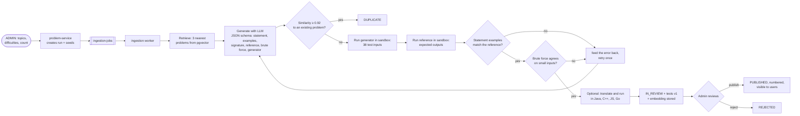

The model writes inputs, never expected outputs; outputs come from executing the reference solution. All
LLM-written code runs in the same sandbox as user code. Problems are original; nothing is scraped.

## 9. Problem lifecycle

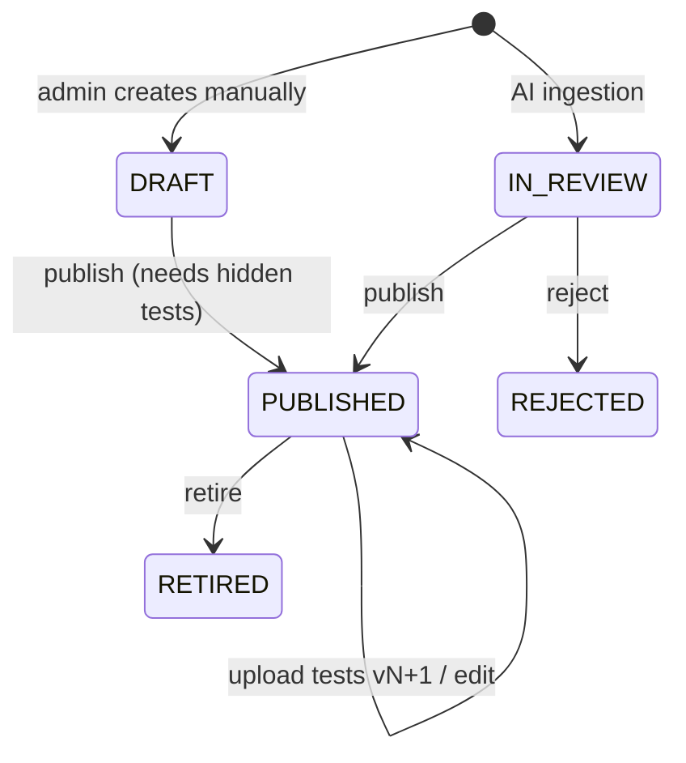

Publishing takes the next problem number from an atomic counter and bumps the list cache version, so every
user sees the new list at once.

## 10. Data ownership

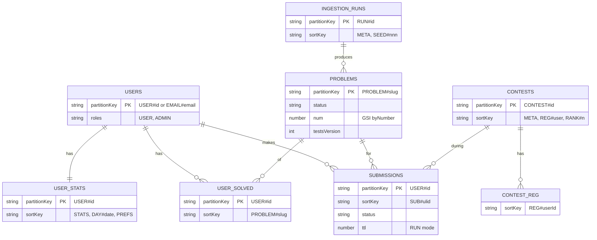

| Store | Holds | Owner |
| --- | --- | --- |
| DynamoDB `Users`, `AuditLog` | accounts, roles, admin actions | auth-service (+ problem-service audit) |
| DynamoDB `Problems` | problem docs, counters, acceptance | problem-service (analytics adds counters) |
| DynamoDB `Submissions` | every run and verdict | submission-service, judge-worker |
| DynamoDB `Contests` | fests, registrations, final standings | contest-service |
| DynamoDB `UserStats`, `UserSolved` | progress, heatmap, preferences | analytics-service |
| DynamoDB `IngestionRuns` | AI run progress | problem-service, ingestion worker |
| S3 `codearena-tests` | `<slug>/v<n>/cases.jsonl`, immutable | problem-service, ingestion |
| S3 `codearena-submissions` | `src/<submissionId>` | submission-service |
| Redis | rate limits, refresh tokens, deny list, caches, leaderboards, contest gate | gateway, auth, problem, submission, contest, analytics |
| pgvector | problem embeddings for RAG and dedupe | ingestion worker |

## 11. Local deployment (this guide)

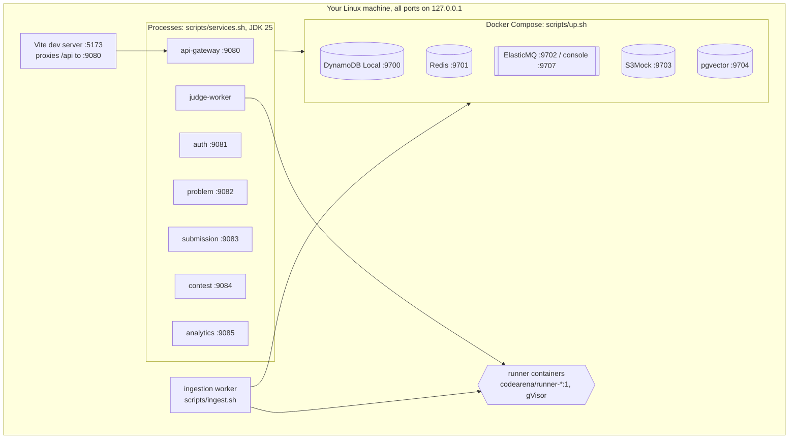

## 12. On AWS (after local testing)

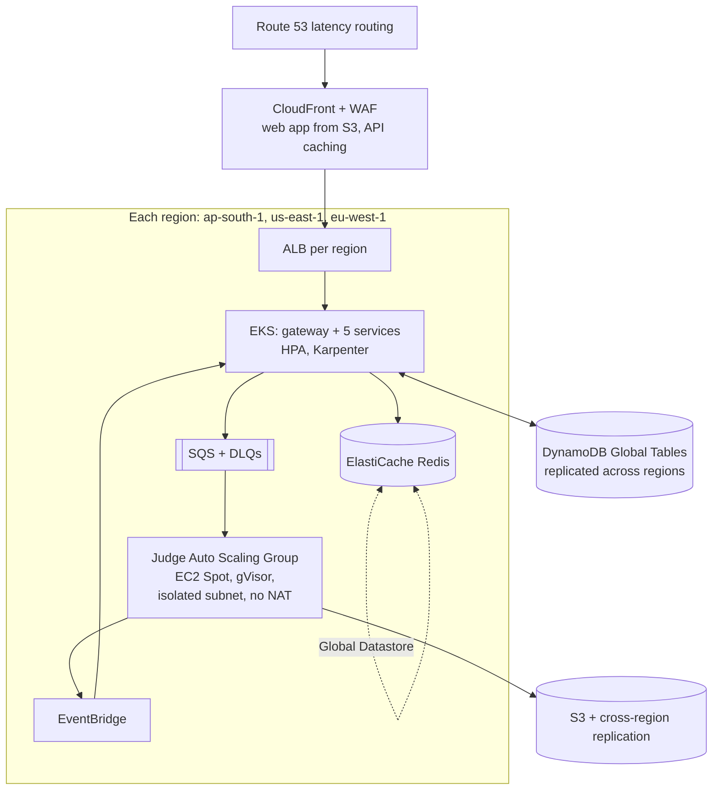

| Local | AWS |
| --- | --- |
| DynamoDB Local | DynamoDB Global Tables (active-active, multi-region) |
| Redis container | ElastiCache (cluster mode) + Global Datastore |
| ElasticMQ, two verdict queues | SQS + EventBridge rules |
| S3Mock | S3 + cross-region replication |
| pgvector container | RDS PostgreSQL with pgvector |
| `java -jar` processes | EKS Deployments behind an ALB |
| judge on your machine | dedicated EC2 Auto Scaling Group on Spot, scaled on queue depth |
| `.local/jwt-private.pem` | Secrets Manager |

Only endpoints and credentials change between the two: the services use the standard AWS SDK throughout.

## 13. Capacity design

| Load | Estimate | Answer in the design |
| --- | --- | --- |
| 1 million users, ~20K concurrent normally | mostly reads | problem list served from one Redis entry; stateless JWT |
| 100K fest users submitting every ~2 min | ~830 submissions/s, bursts ~2,500/s | async queue; contest queue separate; judge fleet scales on queue depth |
| judge CPU at peak | ~415 busy CPUs | Spot instances, pre-warmed before the fest |
| leaderboard polling | 100K / 5 s = 20,000 req/s | one snapshot per 5 s, cacheable; one Redis GET per read |
| login burst at fest start | ~330/s | per-IP rate limit, BCrypt on auth pods only |
````

`architecture.md` opens with a one-page block diagram. Its source is an HTML page; save it as
`docs/architecture-block.html`, open it in a browser, and save a screenshot as `docs/architecture-block.png`
(the PNG also ships ready-made in the repo zip and next to this guide):

**File:** `docs/architecture-block.html`

```html
<!doctype html>
<html lang="en">
<head>
<meta charset="utf-8">
<meta name="viewport" content="width=device-width, initial-scale=1">
<title>CodeArena Block Diagram</title>
<!-- Optional web fonts; the diagram falls back to system fonts offline. -->
<link rel="preconnect" href="https://fonts.googleapis.com">
<link href="https://fonts.googleapis.com/css2?family=Bricolage+Grotesque:wght@600;700&family=IBM+Plex+Sans:wght@400;500;600&family=JetBrains+Mono:wght@400;500&display=swap" rel="stylesheet">
<style>
  :root {
    --bg: #0d1023;
    --panel: #141833;
    --line: #2a3060;
    --text: #e7e9f7;
    --muted: #9aa0c8;
    --amber: #ffb547;

    --client: #5b8cff;
    --edge: #a77bff;
    --service: #3fc4a8;
    --queue: #f0c35a;
    --exec: #ff7a59;
    --data: #4fb3ff;
    --ext: #c2c6e0;

    --display: "Bricolage Grotesque", "Segoe UI", system-ui, sans-serif;
    --body: "IBM Plex Sans", "Segoe UI", system-ui, sans-serif;
    --mono: "JetBrains Mono", ui-monospace, "Cascadia Mono", Consolas, monospace;
  }
  * { box-sizing: border-box; }
  body {
    margin: 0;
    background: var(--bg);
    color: var(--text);
    font: 14px/1.45 var(--body);
  }
  .canvas {
    width: 1440px;
    margin: 0 auto;
    padding: 36px 40px 40px;
  }
  header {
    display: flex;
    align-items: flex-end;
    justify-content: space-between;
    gap: 24px;
    margin-bottom: 26px;
  }
  h1 {
    font: 700 30px/1.1 var(--display);
    margin: 0 0 6px;
    letter-spacing: -0.01em;
  }
  h1 span { color: var(--amber); }
  .sub { color: var(--muted); margin: 0; max-width: 760px; }

  .legend { display: flex; flex-wrap: wrap; gap: 8px 14px; justify-content: flex-end; max-width: 520px; }
  .legend i {
    font-style: normal; font-size: 12px; color: var(--muted);
    display: inline-flex; align-items: center; gap: 6px;
  }
  .legend i::before {
    content: ""; width: 12px; height: 12px; border-radius: 3px;
    background: var(--c); box-shadow: 0 0 0 1px rgba(255,255,255,.15) inset;
  }

  .layout { display: grid; grid-template-columns: 1fr 272px; gap: 22px; }

  /* Layers */
  .layer {
    display: grid;
    grid-template-columns: 132px 1fr;
    gap: 16px;
    align-items: stretch;
  }
  .layer-name {
    border-left: 3px solid var(--c);
    padding: 10px 0 10px 12px;
    font: 600 13px/1.25 var(--display);
    text-transform: uppercase;
    letter-spacing: .06em;
    color: var(--text);
  }
  .layer-name small {
    display: block; margin-top: 4px;
    font: 400 11.5px/1.35 var(--body);
    text-transform: none; letter-spacing: 0; color: var(--muted);
  }
  .row { display: grid; gap: 12px; }
  .cols-2 { grid-template-columns: 2fr 1fr; }
  .cols-3 { grid-template-columns: repeat(3, 1fr); }
  .cols-4 { grid-template-columns: repeat(4, 1fr); }
  .cols-5 { grid-template-columns: repeat(5, 1fr); }
  .exec-row { grid-template-columns: 1.15fr 1.6fr 1.15fr .8fr; }

  .block {
    position: relative;
    background: var(--panel);
    border: 1px solid var(--line);
    border-top: 3px solid var(--c);
    border-radius: 10px;
    padding: 12px 14px 12px;
  }
  .block h3 {
    margin: 0;
    font: 600 15px/1.2 var(--display);
    display: flex; justify-content: space-between; align-items: baseline; gap: 8px;
  }
  .port {
    font: 500 11.5px var(--mono);
    color: var(--c);
    white-space: nowrap;
  }
  .block p { margin: 4px 0 0; color: var(--muted); font-size: 12.5px; }
  .block ul { margin: 8px 0 0; padding: 0; list-style: none; }
  .block li {
    font-size: 12.5px; padding-left: 12px; position: relative; margin-top: 3px;
  }
  .block li::before {
    content: ""; position: absolute; left: 0; top: .62em;
    width: 5px; height: 5px; border-radius: 50%; background: var(--c);
  }

  .chips { display: flex; flex-wrap: wrap; gap: 6px; margin-top: 10px; }
  .chip {
    font: 500 11.5px var(--mono);
    padding: 4px 8px;
    border-radius: 6px;
    border: 1px solid color-mix(in srgb, var(--c) 45%, transparent);
    background: color-mix(in srgb, var(--c) 12%, transparent);
    color: var(--text);
  }

  /* Gateway is one wide block */
  .gateway { display: grid; grid-template-columns: 260px 1fr; gap: 16px; align-items: center; }

  /* Execution plane: hatched, to read as "isolated" */
  .isolated {
    border-style: dashed;
    border-top-style: solid;
    background:
      repeating-linear-gradient(135deg, rgba(255,122,89,.06) 0 8px, transparent 8px 16px),
      var(--panel);
  }
  .runners { display: grid; grid-template-columns: repeat(5, 1fr); gap: 6px; margin-top: 10px; }
  .runner {
    text-align: center; font: 500 11px var(--mono);
    padding: 6px 2px; border-radius: 6px;
    background: rgba(255,122,89,.12); border: 1px solid rgba(255,122,89,.4);
  }
  .external { border-style: dashed; }

  /* Connectors between layers */
  .link {
    display: grid; grid-template-columns: 132px 1fr; gap: 16px;
    height: 34px; align-items: center;
  }
  .link .wire {
    position: relative; height: 100%;
    display: flex; align-items: center; justify-content: center; gap: 28px;
  }
  .link .wire::before {
    content: ""; position: absolute; left: 50%; top: 0; bottom: 0;
    border-left: 2px dashed var(--line);
  }
  .tag {
    position: relative; z-index: 1;
    font: 500 11.5px var(--mono);
    color: var(--amber);
    background: var(--bg);
    border: 1px solid var(--line);
    border-radius: 999px;
    padding: 3px 10px;
  }
  .tag::after { content: " ↓"; color: var(--muted); }
  .tag.up::after { content: " ↑"; }

  /* Sidebar */
  aside { display: flex; flex-direction: column; gap: 14px; }
  .card {
    background: var(--panel); border: 1px solid var(--line); border-radius: 10px;
    padding: 14px 16px;
  }
  .card h4 {
    margin: 0 0 8px; font: 600 13px var(--display);
    text-transform: uppercase; letter-spacing: .06em; color: var(--amber);
  }
  .card ul { margin: 0; padding-left: 16px; }
  .card li { font-size: 12.5px; margin: 4px 0; color: var(--text); }
  .card li b { font-weight: 600; }
  .card .num { font: 700 22px/1 var(--display); color: var(--text); }
  .stat { display: flex; justify-content: space-between; align-items: baseline; padding: 6px 0; border-bottom: 1px solid var(--line); }
  .stat:last-child { border-bottom: 0; }
  .stat span { color: var(--muted); font-size: 12px; }

  footer {
    margin-top: 22px;
    display: grid; grid-template-columns: 1fr 1fr; gap: 14px;
  }
  footer .card h4 { color: var(--text); }
  footer .map { display: flex; flex-wrap: wrap; gap: 6px; }
  footer .map .chip { --c: var(--muted); }
  footer .aws .map .chip { --c: var(--amber); }
</style>
</head>
<body>
<div class="canvas">

  <header>
    <div>
      <h1>CodeArena <span>·</span> system block diagram</h1>
      <p class="sub">Layered view of the platform. Requests flow top to bottom; verdicts and events flow back up through
        queues. User code only ever runs in the isolated execution plane.</p>
    </div>
    <div class="legend">
      <i style="--c:var(--client)">Client</i>
      <i style="--c:var(--edge)">Edge</i>
      <i style="--c:var(--service)">Service</i>
      <i style="--c:var(--queue)">Queue</i>
      <i style="--c:var(--exec)">Isolated execution</i>
      <i style="--c:var(--data)">Data store</i>
      <i style="--c:var(--ext)">External</i>
    </div>
  </header>

  <div class="layout">
    <main>

      <!-- 1. Clients -->
      <section class="layer">
        <div class="layer-name" style="--c:var(--client)">Clients<small>one API for web and mobile</small></div>
        <div class="row cols-3">
          <div class="block" style="--c:var(--client)">
            <h3>Web app <span class="port">:5173</span></h3>
            <p>React 19 · Vite 8 · Tailwind 4 · TanStack Query</p>
            <ul><li>Problem list, 100 per page</li><li>Monaco editor, 5 languages</li><li>Live fest leaderboard</li></ul>
          </div>
          <div class="block" style="--c:var(--client)">
            <h3>Admin console <span class="port">ADMIN</span></h3>
            <p>Same web app, role-gated routes</p>
            <ul><li>Start AI + RAG ingestion</li><li>Review, publish, retire</li><li>Create and freeze fests</li></ul>
          </div>
          <div class="block" style="--c:var(--client)">
            <h3>Mobile apps <span class="port">/api/v1</span></h3>
            <p>Android / iOS, same versioned REST API</p>
            <ul><li>Refresh token in body</li><li>Cursor pagination</li><li>Idempotency-Key on submit</li></ul>
          </div>
        </div>
      </section>

      <div class="link"><div></div><div class="wire"><span class="tag">HTTPS · /api/v1 · Bearer JWT</span></div></div>

      <!-- 2. Edge -->
      <section class="layer">
        <div class="layer-name" style="--c:var(--edge)">Edge<small>single entry point</small></div>
        <div class="block gateway" style="--c:var(--edge)">
          <div>
            <h3>api-gateway <span class="port">:9080</span></h3>
            <p>Spring Cloud Gateway 5 (WebFlux)</p>
          </div>
          <div class="chips" style="margin-top:0">
            <span class="chip">routing</span>
            <span class="chip">JWT verify · JWKS</span>
            <span class="chip">role check /admin</span>
            <span class="chip">logout deny list</span>
            <span class="chip">rate limiter · Redis</span>
            <span class="chip">circuit breaker → 503</span>
            <span class="chip">128 KB body cap</span>
            <span class="chip">strip X-User-*</span>
            <span class="chip">X-Request-Id</span>
            <span class="chip">CORS</span>
          </div>
        </div>
      </section>

      <div class="link"><div></div><div class="wire"><span class="tag">REST · X-User-Id · JWT re-verified</span></div></div>

      <!-- 3. Services -->
      <section class="layer">
        <div class="layer-name" style="--c:var(--service)">Services<small>Spring Boot 4 · Java 25 · stateless</small></div>
        <div class="row cols-5">
          <div class="block" style="--c:var(--service)">
            <h3>auth <span class="port">:9081</span></h3>
            <ul><li>Register, login</li><li>RS256 JWT, 15 min</li><li>Refresh rotation</li><li>JWKS, roles</li></ul>
          </div>
          <div class="block" style="--c:var(--service)">
            <h3>problem <span class="port">:9082</span></h3>
            <ul><li>Catalog + cache</li><li>Starter code ×5</li><li>Hidden test versions</li><li>Ingestion runs</li></ul>
          </div>
          <div class="block" style="--c:var(--service)">
            <h3>submission <span class="port">:9083</span></h3>
            <ul><li>Accept → 202</li><li>Store code in S3</li><li>Queue by mode</li><li>Verdict polling</li></ul>
          </div>
          <div class="block" style="--c:var(--service)">
            <h3>contest <span class="port">:9084</span></h3>
            <ul><li>Fests, registration</li><li>score.lua (ICPC)</li><li>5 s snapshots</li><li>Final standings</li></ul>
          </div>
          <div class="block" style="--c:var(--service)">
            <h3>analytics <span class="port">:9085</span></h3>
            <ul><li>Counters on verdict</li><li>Streaks, heatmap</li><li>Ready at login</li><li>Admin overview</li></ul>
          </div>
        </div>
      </section>

      <div class="link"><div></div><div class="wire"><span class="tag">SubmissionCreated</span><span class="tag up">VerdictReady</span></div></div>

      <!-- 4. Messaging -->
      <section class="layer">
        <div class="layer-name" style="--c:var(--queue)">Messaging<small>ElasticMQ :9702 · SQS on AWS</small></div>
        <div class="block" style="--c:var(--queue)">
          <div class="chips" style="margin-top:0">
            <span class="chip">contest-submissions</span>
            <span class="chip">practice-submissions</span>
            <span class="chip">verdict-events → analytics</span>
            <span class="chip">contest-verdicts → contest</span>
            <span class="chip">ingestion-jobs</span>
            <span class="chip">*-dlq after 3 attempts</span>
          </div>
          <p style="margin-top:8px">Separate contest queue so fest submissions never wait behind practice traffic. At-least-once delivery, idempotent consumers.</p>
        </div>
      </section>

      <div class="link"><div></div><div class="wire"><span class="tag">poll · long-polling consumers</span></div></div>

      <!-- 5. Execution -->
      <section class="layer">
        <div class="layer-name" style="--c:var(--exec)">Execution<small>no HTTP port · isolated</small></div>
        <div class="row exec-row">
          <div class="block" style="--c:var(--exec)">
            <h3>judge-worker</h3>
            <ul><li>Fetch code + tests</li><li>Run, compare outputs</li><li>Conditional verdict write</li><li>Scales on queue depth</li></ul>
          </div>
          <div class="block isolated" style="--c:var(--exec)">
            <h3>gVisor sandboxes <span class="port">runsc</span></h3>
            <p>One throw-away container per run</p>
            <div class="runners">
              <span class="runner">java</span><span class="runner">python</span><span class="runner">cpp</span><span class="runner">js</span><span class="runner">go</span>
            </div>
            <div class="chips">
              <span class="chip">--network=none</span><span class="chip">read-only root</span><span class="chip">pids 128</span>
              <span class="chip">cap-drop ALL</span><span class="chip">uid 65534</span><span class="chip">64 KB output</span>
            </div>
          </div>
          <div class="block" style="--c:var(--exec)">
            <h3>ingestion worker</h3>
            <p>Python · admin-triggered</p>
            <ul><li>RAG retrieve</li><li>Generate, dedupe 0.92</li><li>Verify in sandbox</li><li>Save IN_REVIEW</li></ul>
          </div>
          <div class="block external" style="--c:var(--ext)">
            <h3>LLM</h3>
            <p>Claude API, or offline mock</p>
            <ul><li>Ingestion only</li><li>Output never trusted</li></ul>
          </div>
        </div>
      </section>

      <div class="link"><div></div><div class="wire"><span class="tag">AWS SDK · same code locally and on AWS</span></div></div>

      <!-- 6. Data -->
      <section class="layer">
        <div class="layer-name" style="--c:var(--data)">Data<small>each table has one owner</small></div>
        <div class="row cols-4">
          <div class="block" style="--c:var(--data)">
            <h3>DynamoDB <span class="port">:9700</span></h3>
            <p>Users · Problems · Submissions · Contests · UserStats · UserSolved · IngestionRuns</p>
          </div>
          <div class="block" style="--c:var(--data)">
            <h3>Redis 7.4 <span class="port">:9701</span></h3>
            <p>Caches with TTL · rate limits · refresh tokens · deny list · leaderboard sorted sets</p>
          </div>
          <div class="block" style="--c:var(--data)">
            <h3>S3 <span class="port">:9703</span></h3>
            <p>Submitted source · hidden tests <code>&lt;slug&gt;/v&lt;n&gt;</code>, immutable</p>
          </div>
          <div class="block" style="--c:var(--data)">
            <h3>pgvector <span class="port">:9704</span></h3>
            <p>Problem embeddings for RAG retrieval and duplicate detection</p>
          </div>
        </div>
      </section>

    </main>

    <aside>
      <div class="card">
        <h4>Security</h4>
        <ul>
          <li><b>RS256 JWT</b>, signed only by auth</li>
          <li>Roles checked at gateway <b>and</b> service</li>
          <li>Refresh reuse revokes the family</li>
          <li>Expected outputs never enter the sandbox</li>
          <li>All local ports on 127.0.0.1</li>
        </ul>
      </div>
      <div class="card">
        <h4>Resilience</h4>
        <ul>
          <li>Circuit breakers at gateway and service-to-service</li>
          <li>Queue redelivery + DLQs</li>
          <li>SYSTEM_ERROR after 3 attempts</li>
          <li>Wall-clock kill for runaway code</li>
          <li>Idempotent submit and verdict write</li>
        </ul>
      </div>
      <div class="card">
        <h4>Scale targets</h4>
        <div class="stat"><span>registered users</span><b class="num">1M</b></div>
        <div class="stat"><span>fest concurrency</span><b class="num">100K</b></div>
        <div class="stat"><span>peak submissions/s</span><b class="num">~2.5K</b></div>
        <div class="stat"><span>leaderboard reads/s</span><b class="num">20K</b></div>
        <div class="stat"><span>leaderboard refresh</span><b class="num">5 s</b></div>
      </div>
    </aside>
  </div>

  <footer>
    <div class="card">
      <h4>Runs locally today</h4>
      <div class="map">
        <span class="chip">Docker Compose infra</span><span class="chip">java -jar services</span>
        <span class="chip">Vite dev server</span><span class="chip">gVisor runner images</span>
        <span class="chip">ElasticMQ</span><span class="chip">S3Mock</span><span class="chip">DynamoDB Local</span>
      </div>
    </div>
    <div class="card aws">
      <h4>Maps to AWS later</h4>
      <div class="map">
        <span class="chip">Route 53 + CloudFront + WAF</span><span class="chip">EKS</span><span class="chip">SQS + EventBridge</span>
        <span class="chip">EC2 Spot judge fleet</span><span class="chip">DynamoDB Global Tables</span>
        <span class="chip">ElastiCache</span><span class="chip">S3 CRR</span><span class="chip">RDS pgvector</span>
      </div>
    </div>
  </footer>

</div>
</body>
</html>
```

It is followed by an end-to-end data flow diagram, also an HTML page; save it as `docs/data-flow.html` and its
screenshot as `docs/data-flow.png` (ready-made in the repo zip and next to this guide):

**File:** `docs/data-flow.html`

```html
<!doctype html>
<html lang="en">
<head>
<meta charset="utf-8">
<meta name="viewport" content="width=device-width, initial-scale=1">
<title>CodeArena Data Flow</title>
<!-- Optional web fonts; the page falls back to system fonts offline. -->
<link rel="preconnect" href="https://fonts.googleapis.com">
<link href="https://fonts.googleapis.com/css2?family=Bricolage+Grotesque:wght@600;700&family=IBM+Plex+Sans:wght@400;500;600&family=JetBrains+Mono:wght@400;500;600&display=swap" rel="stylesheet">
<style>
  :root {
    --bg: #0d1023;
    --panel: #141833;
    --panel-2: #1a1f40;
    --line: #2a3060;
    --text: #e7e9f7;
    --muted: #9aa0c8;
    --amber: #ffb547;

    --entity: #5b8cff;
    --edge: #a77bff;
    --process: #3fc4a8;
    --queue: #f0c35a;
    --exec: #ff7a59;
    --store: #4fb3ff;
    --ext: #c2c6e0;

    --display: "Bricolage Grotesque", "Segoe UI", system-ui, sans-serif;
    --body: "IBM Plex Sans", "Segoe UI", system-ui, sans-serif;
    --mono: "JetBrains Mono", ui-monospace, "Cascadia Mono", Consolas, monospace;
  }
  * { box-sizing: border-box; }
  body { margin: 0; background: var(--bg); color: var(--text); font: 14px/1.45 var(--body); }
  .canvas { width: 1440px; margin: 0 auto; padding: 36px 40px 44px; }

  /* Header */
  header { display: grid; grid-template-columns: 1fr auto; gap: 24px; align-items: end; margin-bottom: 22px; }
  h1 { font: 700 30px/1.1 var(--display); margin: 0 0 6px; letter-spacing: -0.01em; }
  h1 span { color: var(--amber); }
  .sub { color: var(--muted); margin: 0; max-width: 820px; }
  .legend { display: grid; grid-template-columns: repeat(4, auto); gap: 8px 16px; font-size: 12px; color: var(--muted); }
  .legend > div { display: flex; align-items: center; gap: 7px; white-space: nowrap; }
  .lg { width: 22px; height: 14px; border: 1.5px solid var(--c); background: color-mix(in srgb, var(--c) 14%, transparent); }
  .lg.entity { border-radius: 2px; }
  .lg.process { border-radius: 8px; }
  .lg.store { border-left: 0; border-right: 0; border-radius: 0; }
  .lg.queue { border-radius: 2px 8px 8px 2px; border-style: dashed solid solid dashed; }
  .lg.arrow { border: 0; background: none; position: relative; }
  .lg.arrow::before { content: ""; position: absolute; left: 0; right: 4px; top: 6px; border-top: 2px solid var(--amber); }
  .lg.arrow::after { content: ""; position: absolute; right: 0; top: 2px; border: 5px solid transparent; border-left: 7px solid var(--amber); border-right: 0; }

  /* Journey strip */
  .journey { display: flex; align-items: center; gap: 0; margin: 4px 0 26px; padding: 12px 14px;
    background: var(--panel); border: 1px solid var(--line); border-radius: 12px; }
  .journey .step { display: flex; align-items: center; gap: 8px; font: 600 13px var(--display); white-space: nowrap; }
  .journey .step b { display: inline-grid; place-items: center; width: 24px; height: 24px; border-radius: 50%;
    background: var(--amber); color: #1a1300; font: 700 12px var(--mono); }
  .journey .sep { flex: 1; height: 2px; margin: 0 10px; min-width: 18px;
    background: repeating-linear-gradient(90deg, var(--line) 0 6px, transparent 6px 10px); }

  /* Phases */
  .phase { background: var(--panel); border: 1px solid var(--line); border-radius: 14px; padding: 16px 18px 16px;
    margin-bottom: 16px; }
  .phase-head { display: flex; align-items: baseline; gap: 12px; margin-bottom: 14px; }
  .phase-head .n { display: inline-grid; place-items: center; width: 30px; height: 30px; border-radius: 50%;
    background: var(--amber); color: #1a1300; font: 700 14px var(--mono); flex: none; align-self: center; }
  .phase-head h2 { margin: 0; font: 700 19px/1.2 var(--display); }
  .phase-head p { margin: 0; color: var(--muted); font-size: 13px; }
  .phase-head .who { margin-left: auto; font: 500 11.5px var(--mono); color: var(--muted);
    border: 1px solid var(--line); border-radius: 999px; padding: 3px 10px; white-space: nowrap; }

  .flow { display: flex; align-items: stretch; }
  .flow + .flow { margin-top: 12px; }

  /* Nodes */
  .node { flex: 1 1 0; min-width: 0; position: relative; padding: 10px 12px 10px;
    border: 1.5px solid var(--c); background: color-mix(in srgb, var(--c) 9%, var(--panel-2)); }
  .node h3 { margin: 0; font: 600 14px/1.2 var(--display); display: flex; gap: 8px; align-items: baseline; }
  .node h3 .id { font: 600 11px var(--mono); color: var(--c); }
  .node p { margin: 4px 0 0; font-size: 12px; color: var(--muted); }
  .entity { --c: var(--entity); border-radius: 3px; }
  .edge { --c: var(--edge); border-radius: 10px; }
  .process { --c: var(--process); border-radius: 12px; }
  .queue { --c: var(--queue); border-radius: 3px 16px 16px 3px; border-left-style: dashed; }
  .exec { --c: var(--exec); border-radius: 12px; border-style: dashed;
    background: repeating-linear-gradient(135deg, rgba(255,122,89,.07) 0 7px, transparent 7px 14px), var(--panel-2); }
  .ext { --c: var(--ext); border-radius: 12px; border-style: dashed; }
  .narrow { flex: .72 1 0; }
  .wide { flex: 1.35 1 0; }

  /* Store tags inside nodes */
  .io { display: flex; flex-wrap: wrap; gap: 4px; margin-top: 8px; }
  .st { font: 500 10.5px/1 var(--mono); padding: 4px 6px 4px 5px; color: var(--text);
    border-top: 1.5px solid var(--store); border-bottom: 1.5px solid var(--store);
    background: rgba(79,179,255,.10); white-space: nowrap; }
  .st i { font-style: normal; font-weight: 600; margin-right: 4px; padding: 0 3px; border-radius: 3px; }
  .st i.r { background: rgba(79,179,255,.28); }
  .st i.w { background: rgba(255,181,71,.30); color: #ffe3b3; }
  .st i.rw { background: linear-gradient(90deg, rgba(79,179,255,.3), rgba(255,181,71,.3)); }

  /* Arrows */
  .arrow { flex: 0 0 132px; display: flex; flex-direction: column; justify-content: center; align-items: stretch;
    padding: 0 8px; gap: 5px; }
  .arrow .lbl { font: 500 10.5px/1.3 var(--mono); color: var(--amber); text-align: center; }
  .arrow .ln { height: 2px; background: var(--amber); position: relative; margin-right: 6px; }
  .arrow .ln::after { content: ""; position: absolute; right: -7px; top: -5px;
    border: 6px solid transparent; border-left: 8px solid var(--amber); border-right: 0; }
  .arrow .lbl.below { color: var(--muted); }
  .arrow.short { flex-basis: 96px; }

  .reads { display: grid; grid-template-columns: repeat(3, 1fr); gap: 18px; }
  .reads .flow + .flow { margin-top: 0; }
  .reads .flow { padding: 10px; border: 1px dashed var(--line); border-radius: 12px; }
  .reads .arrow { flex-basis: 118px; }

  /* Returns */
  .ret { margin-top: 10px; display: flex; gap: 8px; flex-wrap: wrap; }
  .ret span { font: 500 11.5px var(--mono); color: var(--text); padding: 5px 10px; border-radius: 8px;
    border: 1px dashed color-mix(in srgb, var(--amber) 60%, transparent); background: rgba(255,181,71,.06); }
  .ret span::before { content: "↩ "; color: var(--amber); }

  /* Bottom: stores + dictionary */
  .bottom { display: grid; grid-template-columns: 430px 1fr; gap: 16px; margin-top: 6px; }
  .card { background: var(--panel); border: 1px solid var(--line); border-radius: 14px; padding: 16px 18px; }
  .card h2 { margin: 0 0 10px; font: 700 17px var(--display); }
  .stores { display: grid; grid-template-columns: 1fr; gap: 6px; }
  .store-row { display: grid; grid-template-columns: 36px 1fr; gap: 10px; align-items: center;
    border-top: 1.5px solid var(--store); border-bottom: 1.5px solid var(--store); background: rgba(79,179,255,.07);
    padding: 5px 10px 5px 0; }
  .store-row b { font: 600 12px var(--mono); color: var(--store); text-align: center;
    border-right: 1.5px solid var(--store); }
  .store-row span { font-size: 12.5px; }
  .store-row small { color: var(--muted); }
  table { width: 100%; border-collapse: collapse; font-size: 12.5px; }
  th { text-align: left; font: 600 11.5px var(--display); text-transform: uppercase; letter-spacing: .05em;
    color: var(--muted); padding: 6px 8px; border-bottom: 1px solid var(--line); }
  td { padding: 6px 8px; border-bottom: 1px solid var(--line); vertical-align: top; }
  tr:last-child td { border-bottom: 0; }
  td:first-child { font-weight: 600; white-space: nowrap; }
  td code { font: 500 11.5px var(--mono); color: var(--amber); }
  .note { margin-top: 14px; color: var(--muted); font-size: 12px; }
</style>
</head>
<body>
<div class="canvas">

  <header>
    <div>
      <h1>CodeArena <span>·</span> data flow, end to end</h1>
      <p class="sub">Follows the data from the moment an admin creates a problem to the stats a user sees at their next
        login. Arrows are labelled with the data they carry; tags inside each step show which data store it
        <b>R</b>eads or <b>W</b>rites. Every user request passes the gateway (JWT, role, rate limit) first.</p>
    </div>
    <div class="legend">
      <div><span class="lg entity" style="--c:var(--entity)"></span>person</div>
      <div><span class="lg process" style="--c:var(--process)"></span>process</div>
      <div><span class="lg queue" style="--c:var(--queue)"></span>queue</div>
      <div><span class="lg store" style="--c:var(--store)"></span>data store</div>
      <div><span class="lg process" style="--c:var(--edge)"></span>gateway</div>
      <div><span class="lg process" style="--c:var(--exec); border-style:dashed"></span>sandbox</div>
      <div><span class="lg process" style="--c:var(--ext); border-style:dashed"></span>external</div>
      <div><span class="lg arrow"></span>data moving</div>
    </div>
  </header>

  <div class="journey">
    <div class="step"><b>1</b>Create problem</div><div class="sep"></div>
    <div class="step"><b>2</b>Sign in</div><div class="sep"></div>
    <div class="step"><b>3</b>Browse &amp; open</div><div class="sep"></div>
    <div class="step"><b>4</b>Submit</div><div class="sep"></div>
    <div class="step"><b>5</b>Judge</div><div class="sep"></div>
    <div class="step"><b>6</b>Fan out results</div><div class="sep"></div>
    <div class="step"><b>7</b>See results</div>
  </div>

  <!-- 1 -->
  <section class="phase">
    <div class="phase-head">
      <span class="n">1</span>
      <div><h2>Create a problem with AI + RAG</h2>
        <p>The model writes the statement, solutions and an input generator; expected outputs come only from running the reference solution.</p></div>
      <span class="who">ADMIN only</span>
    </div>
    <div class="flow">
      <div class="node entity narrow"><h3>Admin</h3><p>admin console</p></div>
      <div class="arrow"><div class="lbl">topics, difficulty, count + JWT</div><div class="ln"></div></div>
      <div class="node process"><h3><span class="id">P1</span>problem-service</h3><p>create run, one seed per problem</p>
        <div class="io"><span class="st"><i class="w">W</i>D6 IngestionRuns</span></div></div>
      <div class="arrow"><div class="lbl">job: runId, seed</div><div class="ln"></div></div>
      <div class="node queue narrow"><h3>ingestion-jobs</h3><p>SQS</p></div>
      <div class="arrow short"><div class="lbl">job</div><div class="ln"></div></div>
      <div class="node process wide"><h3><span class="id">P2</span>ingestion worker</h3><p>retrieve 3 nearest problems, generate, dedupe at 0.92</p>
        <div class="io"><span class="st"><i class="r">R</i>D10 pgvector</span><span class="st"><i class="rw">RW</i>D6 IngestionRuns</span></div></div>
      <div class="arrow"><div class="lbl">prompt + 3 similar problems</div><div class="ln"></div><div class="lbl below">← draft JSON</div></div>
      <div class="node ext narrow"><h3>LLM</h3><p>Claude or offline mock</p></div>
    </div>
    <div class="flow">
      <div class="node process wide"><h3><span class="id">P2</span>ingestion worker</h3><p>verify the draft before anyone sees it</p></div>
      <div class="arrow"><div class="lbl">generator, reference, brute force</div><div class="ln"></div><div class="lbl below">← 38 inputs + outputs</div></div>
      <div class="node exec"><h3>gVisor sandbox</h3><p>examples must match, brute force must agree</p></div>
      <div class="arrow"><div class="lbl">verified problem</div><div class="ln"></div></div>
      <div class="node process wide"><h3><span class="id">P2</span>save for review</h3><p>status IN_REVIEW, tests v1, embedding</p>
        <div class="io"><span class="st"><i class="w">W</i>D2 Problems</span><span class="st"><i class="w">W</i>D7 S3 tests</span><span class="st"><i class="w">W</i>D10 pgvector</span></div></div>
      <div class="arrow"><div class="lbl">publish decision</div><div class="ln"></div></div>
      <div class="node process"><h3><span class="id">P1</span>publish</h3><p>next number, PUBLISHED, list cache version +1</p>
        <div class="io"><span class="st"><i class="w">W</i>D2 Problems</span><span class="st"><i class="w">W</i>D9 Redis</span></div></div>
    </div>
  </section>

  <!-- 2 -->
  <section class="phase">
    <div class="phase-head">
      <span class="n">2</span>
      <div><h2>Register and sign in</h2>
        <p>Only auth-service holds the private key; everyone else verifies tokens with its public keys (JWKS).</p></div>
      <span class="who">USER and ADMIN</span>
    </div>
    <div class="flow">
      <div class="node entity narrow"><h3>User</h3><p>browser or mobile app</p></div>
      <div class="arrow"><div class="lbl">email, password</div><div class="ln"></div></div>
      <div class="node edge"><h3>api-gateway</h3><p>per-IP rate limit on /auth</p>
        <div class="io"><span class="st"><i class="rw">RW</i>D9 Redis rate buckets</span></div></div>
      <div class="arrow"><div class="lbl">credentials</div><div class="ln"></div></div>
      <div class="node process wide"><h3><span class="id">P3</span>auth-service</h3><p>BCrypt check (hash stored at register), sign RS256 JWT, rotate refresh token</p>
        <div class="io"><span class="st"><i class="rw">RW</i>D1 Users</span><span class="st"><i class="w">W</i>D9 refresh hash</span></div></div>
      <div class="arrow"><div class="lbl">public keys only</div><div class="ln"></div></div>
      <div class="node edge"><h3>gateway + services</h3><p>cache JWKS, verify every later request locally</p></div>
    </div>
    <div class="ret"><span>User receives: access JWT (15 min, 5 for admins) + refresh token in an HttpOnly cookie</span><span>Logout: token id on the deny list in D9 until it expires</span></div>
  </section>

  <!-- 3 -->
  <section class="phase">
    <div class="phase-head">
      <span class="n">3</span>
      <div><h2>Browse the list and open a problem</h2>
        <p>Reads are served from Redis; DynamoDB is only touched on a cache miss.</p></div>
      <span class="who">USER</span>
    </div>
    <div class="flow">
      <div class="node entity narrow"><h3>User</h3><p>problem list, page n</p></div>
      <div class="arrow"><div class="lbl">page, filters + JWT</div><div class="ln"></div></div>
      <div class="node edge"><h3>api-gateway</h3><p>verify JWT, add X-User-Id</p></div>
      <div class="arrow"><div class="lbl">request + user id</div><div class="ln"></div></div>
      <div class="node process wide"><h3><span class="id">P4</span>problem-service</h3><p>100 per page; solved ticks for this user</p>
        <div class="io"><span class="st"><i class="r">R</i>D9 list cache</span><span class="st"><i class="r">R</i>D2 on miss</span><span class="st"><i class="r">R</i>D5 UserSolved</span></div></div>
      <div class="arrow"><div class="lbl">slug</div><div class="ln"></div></div>
      <div class="node process wide"><h3><span class="id">P4</span>problem detail</h3><p>statement, examples, starter code generated for 5 languages from one signature</p>
        <div class="io"><span class="st"><i class="r">R</i>D9 detail cache</span><span class="st"><i class="r">R</i>D2</span><span class="st"><i class="r">R</i>D5 PREFS</span></div></div>
    </div>
    <div class="ret"><span>User receives: 100 problems with title, difficulty, acceptance, solved tick</span><span>Then: statement + examples + starter code, editor opens in the preferred language</span></div>
  </section>

  <!-- 4 -->
  <section class="phase">
    <div class="phase-head">
      <span class="n">4</span>
      <div><h2>Run or submit code</h2>
        <p>submission-service never runs code: it stores, queues and answers 202 in milliseconds.</p></div>
      <span class="who">USER</span>
    </div>
    <div class="flow">
      <div class="node entity narrow"><h3>User</h3><p>presses Submit</p></div>
      <div class="arrow"><div class="lbl">code, lang, mode, contestId? Idempotency-Key</div><div class="ln"></div></div>
      <div class="node edge"><h3>api-gateway</h3><p>size ≤ 128 KB, per-user rate limit, breaker</p>
        <div class="io"><span class="st"><i class="rw">RW</i>D9 rate buckets</span></div></div>
      <div class="arrow"><div class="lbl">submission</div><div class="ln"></div></div>
      <div class="node process wide"><h3><span class="id">P5</span>submission-service</h3><p>check problem limits and fest window, save code, record PENDING</p>
        <div class="io"><span class="st"><i class="r">R</i>D9 judge meta, fest gate</span><span class="st"><i class="w">W</i>D8 S3 source</span><span class="st"><i class="w">W</i>D3 PENDING</span></div></div>
      <div class="arrow"><div class="lbl">SubmissionCreated: id, user, slug, lang, testsVersion</div><div class="ln"></div></div>
      <div class="node queue"><h3>contest- or practice-submissions</h3><p>fest traffic has its own queue</p></div>
    </div>
    <div class="ret"><span>User receives at once: 202 {submissionId}; the editor then polls GET /submissions/{id}</span></div>
  </section>

  <!-- 5 -->
  <section class="phase">
    <div class="phase-head">
      <span class="n">5</span>
      <div><h2>Judge the code</h2>
        <p>Inputs go into the sandbox; expected outputs never do. A verdict is written only if the submission is still PENDING.</p></div>
      <span class="who">no user involved</span>
    </div>
    <div class="flow">
      <div class="node queue narrow"><h3>submissions</h3><p>SQS</p></div>
      <div class="arrow short"><div class="lbl">event</div><div class="ln"></div></div>
      <div class="node process"><h3><span class="id">P6</span>judge-worker</h3><p>fetch source, tests by version, harness</p>
        <div class="io"><span class="st"><i class="r">R</i>D8 source</span><span class="st"><i class="r">R</i>D7 tests</span></div></div>
      <div class="arrow"><div class="lbl">code + harness + test inputs</div><div class="ln"></div><div class="lbl below">← results.jsonl, time, memory</div></div>
      <div class="node exec wide"><h3>gVisor sandbox</h3><p>no network, read-only, CPU, memory and process limits; killed on timeout</p></div>
      <div class="arrow"><div class="lbl">actual outputs</div><div class="ln"></div></div>
      <div class="node process"><h3><span class="id">P6</span>compare + verdict</h3><p>against expected outputs held on the host</p>
        <div class="io"><span class="st"><i class="w">W</i>D3 verdict</span></div></div>
      <div class="arrow"><div class="lbl">VerdictReady: verdict, passed/total, ms, MB</div><div class="ln"></div></div>
      <div class="node queue narrow"><h3>verdict-events + contest-verdicts</h3></div>
    </div>
  </section>

  <!-- 6 -->
  <section class="phase">
    <div class="phase-head">
      <span class="n">6</span>
      <div><h2>Fan out the result</h2>
        <p>One verdict updates progress, problem acceptance and the fest leaderboard, each through its own queue.</p></div>
      <span class="who">no user involved</span>
    </div>
    <div class="flow">
      <div class="node queue" style="flex:0 0 230px"><h3>verdict-events</h3><p>SQS</p></div>
      <div class="arrow"><div class="lbl">every verdict</div><div class="ln"></div></div>
      <div class="node process wide"><h3><span class="id">P7</span>analytics-service</h3><p>atomic ADD counters: solved by difficulty, languages, today's heatmap cell, streak; first-solve marker</p>
        <div class="io"><span class="st"><i class="w">W</i>D5 UserStats</span><span class="st"><i class="w">W</i>D5 UserSolved</span><span class="st"><i class="w">W</i>D2 acceptance</span></div></div>
    </div>
    <div class="flow">
      <div class="node queue" style="flex:0 0 230px"><h3>contest-verdicts</h3><p>SQS</p></div>
      <div class="arrow"><div class="lbl">fest verdicts only</div><div class="ln"></div></div>
      <div class="node process wide"><h3><span class="id">P8</span>contest-service</h3><p>score.lua: dedupe, count wrong tries, solved×10⁶ − penalty; every 5 s one pod writes the top-100 snapshot</p>
        <div class="io"><span class="st"><i class="rw">RW</i>D9 lb:{cid}</span><span class="st"><i class="w">W</i>D9 lb:snap (10 s TTL)</span></div></div>
    </div>
  </section>

  <!-- 7 -->
  <section class="phase">
    <div class="phase-head">
      <span class="n">7</span>
      <div><h2>See the results</h2>
        <p>Everything the user sees here was computed in advance, so each read is a single key lookup.</p></div>
      <span class="who">USER</span>
    </div>
    <div class="reads">
      <div class="flow">
        <div class="node entity narrow"><h3>User</h3><p>editor polling</p></div>
        <div class="arrow"><div class="lbl">GET /submissions/{id}</div><div class="ln"></div></div>
        <div class="node process"><h3><span class="id">P5</span>submission-service</h3><p>status and verdict</p>
          <div class="io"><span class="st"><i class="r">R</i>D3</span></div></div>
      </div>
      <div class="flow">
        <div class="node entity narrow"><h3>Fest viewers</h3><p>up to 100K</p></div>
        <div class="arrow"><div class="lbl">GET leaderboard every 5 s</div><div class="ln"></div></div>
        <div class="node process"><h3><span class="id">P8</span>contest-service</h3><p>one GET per viewer; Cache-Control 5 s</p>
          <div class="io"><span class="st"><i class="r">R</i>D9 lb:snap</span><span class="st"><i class="w">W</i>D4 final ranks at end</span></div></div>
      </div>
      <div class="flow">
        <div class="node entity narrow"><h3>User</h3><p>next login</p></div>
        <div class="arrow"><div class="lbl">GET /me/stats</div><div class="ln"></div></div>
        <div class="node process"><h3><span class="id">P7</span>analytics-service</h3><p>no computation at read time</p>
          <div class="io"><span class="st"><i class="r">R</i>D5 UserStats</span><span class="st"><i class="r">R</i>D9 cache</span></div></div>
      </div>
    </div>
    <div class="ret"><span>Verdict: ACCEPTED, 17/17 tests, 42 ms, 14 MB (or the first failing example)</span><span>Fest board: rank, solved, penalty, per-problem cells</span><span>Dashboard: solved by difficulty, streak, heatmap, languages</span></div>
  </section>

  <div class="bottom">
    <div class="card">
      <h2>Data stores</h2>
      <div class="stores">
        <div class="store-row"><b>D1</b><span>Users <small>· DynamoDB · accounts, BCrypt hashes, roles</small></span></div>
        <div class="store-row"><b>D2</b><span>Problems <small>· DynamoDB · statement, signature, status, counters</small></span></div>
        <div class="store-row"><b>D3</b><span>Submissions <small>· DynamoDB · status, verdict, timings</small></span></div>
        <div class="store-row"><b>D4</b><span>Contests <small>· DynamoDB · fests, registrations, final ranks</small></span></div>
        <div class="store-row"><b>D5</b><span>UserStats, UserSolved <small>· DynamoDB · progress, prefs</small></span></div>
        <div class="store-row"><b>D6</b><span>IngestionRuns <small>· DynamoDB · AI run and seed status</small></span></div>
        <div class="store-row"><b>D7</b><span>S3 codearena-tests <small>· hidden tests, immutable versions</small></span></div>
        <div class="store-row"><b>D8</b><span>S3 codearena-submissions <small>· submitted source</small></span></div>
        <div class="store-row"><b>D9</b><span>Redis <small>· caches, rate limits, tokens, leaderboards</small></span></div>
        <div class="store-row"><b>D10</b><span>pgvector <small>· problem embeddings for RAG</small></span></div>
      </div>
    </div>
    <div class="card">
      <h2>Data dictionary</h2>
      <table>
        <thead><tr><th>Data</th><th>Shape</th><th>Created by</th><th>Kept in</th><th>Lifetime</th></tr></thead>
        <tbody>
          <tr><td>Access token</td><td>RS256 JWT: <code>sub</code>, <code>roles</code>, <code>jti</code></td><td>P3 auth</td><td>client memory only</td><td>15 min (admin 5)</td></tr>
          <tr><td>Refresh token</td><td>random 256-bit; only its SHA-256 is stored</td><td>P3 auth</td><td>HttpOnly cookie, D9</td><td>7 days, single use</td></tr>
          <tr><td>Problem</td><td>statement, examples, signature, limits</td><td>P2 or admin</td><td>D2</td><td>until retired</td></tr>
          <tr><td>Hidden tests</td><td><code>cases.jsonl</code> (input, expected)</td><td>P2 / admin upload</td><td>D7 <code>&lt;slug&gt;/v&lt;n&gt;</code></td><td>permanent, versioned</td></tr>
          <tr><td>Source code</td><td>text ≤ 64 KB</td><td>user</td><td>D8 <code>src/&lt;id&gt;</code></td><td>permanent (Run: 1 day)</td></tr>
          <tr><td>SubmissionCreated</td><td>JSON event: id, user, slug, lang, version</td><td>P5</td><td>SQS</td><td>until judged, DLQ after 3 tries</td></tr>
          <tr><td>VerdictReady</td><td>JSON event: verdict, passed/total, ms, MB</td><td>P6</td><td>SQS ×2</td><td>until consumed</td></tr>
          <tr><td>Leaderboard</td><td>sorted set + per-problem hashes; JSON snapshot</td><td>P8</td><td>D9</td><td>snapshot 10 s; set 7 days after fest</td></tr>
          <tr><td>User stats</td><td>counters, day cells, streak</td><td>P7</td><td>D5</td><td>permanent</td></tr>
        </tbody>
      </table>
      <p class="note">Same flow on AWS: DynamoDB Global Tables, S3, SQS, ElastiCache and RDS pgvector replace the local stores; no arrow changes.</p>
    </div>
  </div>

</div>
</body>
</html>
```

## Your requirements, and where each one is built

| # | Requirement | Chapter |
| --- | --- | --- |
| 1 | JWT login, authentication and authorization; gateway with routing, circuit breaker, rate limiter, security | 04, 05 |
| — | Two roles: ADMIN ingests problems with AI + RAG, USER solves and submits | 04, 05, 13, 14 |
| 2 | Problem list paginated at 100 | 06, 13 |
| 3 | Problem page with examples and an editor for several languages | 06, 13 |
| 4 | Editor pre-filled with starter code for every language | 03, 06 |
| 5 | 1 million users, 100,000 during a fest | 00 (capacity), 10, 15 |
| 6 | Live fest leaderboard | 10, 13 |
| 7 | NoSQL (DynamoDB), Redis cache with TTL, leaderboard refreshed every 5 s | 02, 06, 10 |
| 8 | User code isolated in containers with security controls | 07, 09 |
| 9 | AI + RAG pipeline to ingest 1,000+ problems with starter code | 14 |
| 10 | Fault tolerance against malicious code | 07, 09, 15 |
| 11 | Analytics service; stats shown at next login | 11, 13 |
| 12 | Globally distributed database on AWS | after this guide (the AWS plan in the CodeArena doc) |
| — | Best-in-class web UI; APIs reusable by mobile apps | 05, 13 |

A note on requirement 9. LeetCode's terms of service forbid scraping, and its problem statements are copyrighted, so
nothing here copies them. Chapter 14 builds the same AI + RAG pipeline to write *original* problems from a topic
list, verifies each one by running code in the sandbox, and puts it in front of an admin before publishing.
The seven seed problems in chapter 06 are original too.

## Chapters

| Chapter | You build | Check at the end |
| --- | --- | --- |
| 01 Prerequisites and repo | Tools, Gradle monorepo, convention plugins | `./gradlew help` works |
| 02 Local infrastructure | Docker Compose: DynamoDB Local, Redis, ElasticMQ, S3Mock, pgvector; scripts | `scripts/up.sh` seeds 7 problems |
| 03 Shared libraries | Events, roles, errors, DynamoDB helpers, starter-code generator | `./gradlew :libs:codegen:build` |
| 04 Auth service | JWT (RS256), refresh rotation, JWKS, admin roles | register, login, JWKS by curl |
| 05 API gateway | Routes, JWT + role checks, rate limits, circuit breakers | 403 for users on admin API, 429 on bursts |
| 06 Problem service | Catalog, 100-per-page, starter code, admin review, seed data | problem list through the gateway |
| 07 Sandbox runners | gVisor, one runner image per language | run a solution by hand in the sandbox |
| 08 Submission service | Accept, store, queue, poll | submission goes PENDING |
| 09 Judge worker | Sandbox execution, judging, red-team tests | correct code is ACCEPTED, a loop is TLE |
| 10 Contest service | Fests, ICPC scoring in Lua, 5-second snapshots | leaderboard updates |
| 11 Analytics service | Stats, streaks, heatmap, admin overview | stats after a solve |
| 12 Run everything | One-command start, end-to-end smoke test | `scripts/smoke.sh` all green |
| 13 Web app | React UI: list, workspace, fests, progress, admin console | the full app in the browser |
| 14 AI + RAG ingestion | Python worker: generate, retrieve, dedupe, verify, review | a run fills the review queue |
| 15 Testing and hardening | Unit, red-team, load tests; security checklist | k6 thresholds pass |
| 16 Troubleshooting | Symptoms and fixes | |

## Versions

Gradle 9.1 · Java 25 · Spring Boot 4.0.9 · Spring Cloud 2025.1.3 · Spring Cloud AWS 4.0.2 · Jackson 3 ·
Testcontainers 2 · React 19 · React Router 8 · Vite 8 · TypeScript 7 · Tailwind 4.3 · Python 3.13 · Node 24.
Runner images: Java 25, Python 3.13, GCC 15 (C++20), Node 24, Go 1.25. All versions live in
`build-logic/src/main/kotlin/Versions.kt` and `frontend/package.json`.

## Ports (all bound to 127.0.0.1)

| Port | What |
| --- | --- |
| 5173 | Web app (Vite dev server, proxies /api to the gateway) |
| 9080 | api-gateway, the only API entry point |
| 9081–9085 | auth, problem, submission, contest, analytics services |
| 9700 | DynamoDB Local |
| 9701 | Redis |
| 9702 / 9707 | ElasticMQ (SQS API / web console) |
| 9703 | S3Mock |
| 9704 | PostgreSQL + pgvector |
| 9705 / 9706 | DynamoDB admin, RedisInsight (optional: `TOOLS=1 scripts/up.sh`) |

Ports are in the 9xxx range on purpose so they do not clash with other local stacks (such as QuickBite on 8080).

## Capacity: what 1 million users and a 100,000-person fest mean

The design is sized for this; your laptop obviously runs a scaled-down version of it.

| Load | Estimate | Design answer |
| --- | --- | --- |
| Fest submissions | 100K users, one submit every ~2 min, about 830/s, bursts to ~2,500/s | Queue + async judging; nothing waits in the request path |
| Judge CPU | 830/s × ~0.5 s ≈ 415 busy CPUs at peak | Horizontally scaled judge hosts, separate contest queue |
| Leaderboard reads | 100K clients polling every 5 s = 20,000 req/s | One precomputed snapshot every 5 s, cacheable for 5 s |
| Problem list | Read-mostly | Whole list cached in Redis, paged in memory |
| Login burst at fest start | ~330/s | Stateless JWT; services verify with a cached public key |

## What was tested while writing this guide, and what you will test first

Run in the author's environment: the frontend type-checks and builds, and every page was reviewed in a headless
browser at desktop and phone widths. The starter-code and harness templates were rendered and executed with real
Python, Node, g++ and Go toolchains for every parameter type, and the Java harness compiles. The seed problems'
reference solutions were cross-checked against brute force on 300 random inputs each. The ingestion pipeline's
verification logic has unit tests (7 passing), and the extractor reproduces the repository byte for byte.

Not run there, because that environment had no Docker daemon and no Maven Central access: the Gradle build of the
Java services, the sandbox containers, and the full stack. The move to Gradle 9.1, Java 25, Spring Boot 4.0 and
Jackson 3 was done against the official compatibility tables and migration guides, but it has not been compiled yet:
your first `./gradlew build` is its first compile. Chapter 12's `scripts/smoke.sh` is your first
end-to-end proof; chapter 16 lists the fixes for what most often goes wrong.
