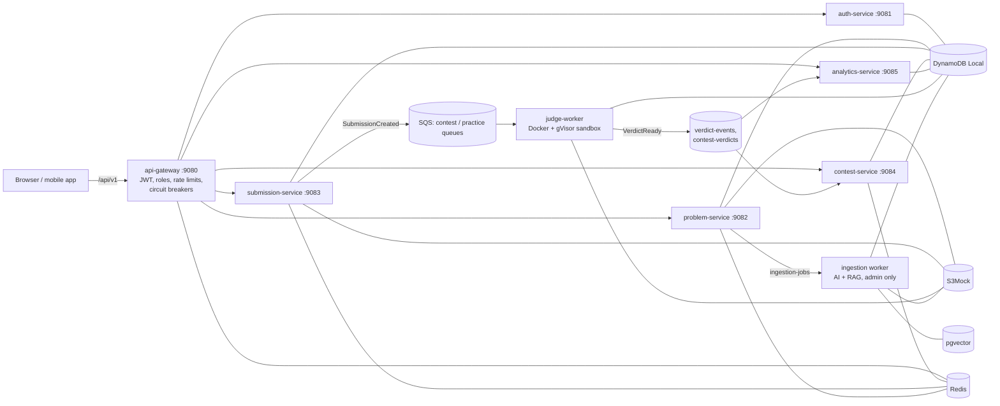

# CodeArena: build a LeetCode-style platform, step by step (local edition)

This guide builds the whole platform on your own Linux machine: no cloud account, no costs. Every chapter adds one
working piece and ends with a check you can run. The AWS deployment comes later, once everything here is tested.

## How to use this guide

Each chapter contains complete files. A file block is always introduced by a line like **File:** `path/to/File.java`.
You can type them in yourself (recommended for the parts you want to learn deeply) or let `extract_code.py` write them:

```bash
mkdir -p ~/Projects/codearena && cd ~/Projects/codearena
python3 /path/to/extract_code.py /path/to/codearena-guide/01-*.md            # dry run: lists the files
python3 /path/to/extract_code.py /path/to/codearena-guide/01-*.md --write    # writes them
python3 /path/to/extract_code.py /path/to/codearena-guide/*.md --write       # every chapter at once
```

Existing files are never overwritten unless you add `--force`. Code shown without a **File:** line is an
example or a command, never a file to create. The complete repository is also in `codearena-repo.zip`.

## What you are building



## Your requirements, and where each one is built

| # | Requirement | Chapter |
| --- | --- | --- |
| 1 | JWT login, authentication and authorization; gateway with routing, circuit breaker, rate limiter, security | 04, 05 |
| — | Two roles: ADMIN ingests problems with AI + RAG, USER solves and submits | 04, 05, 13, 14 |
| 2 | Problem list paginated at 100 | 06, 13 |
| 3 | Problem page with examples and an editor for several languages | 06, 13 |
| 4 | Editor pre-filled with starter code for every language | 03, 06 |
| 5 | 1 million users, 100,000 during a fest | 00 (capacity), 10, 15 |
| 6 | Live fest leaderboard | 10, 13 |
| 7 | NoSQL (DynamoDB), Redis cache with TTL, leaderboard refreshed every 5 s | 02, 06, 10 |
| 8 | User code isolated in containers with security controls | 07, 09 |
| 9 | AI + RAG pipeline to ingest 1,000+ problems with starter code | 14 |
| 10 | Fault tolerance against malicious code | 07, 09, 15 |
| 11 | Analytics service; stats shown at next login | 11, 13 |
| 12 | Globally distributed database on AWS | after this guide (the AWS plan in the CodeArena doc) |
| — | Best-in-class web UI; APIs reusable by mobile apps | 05, 13 |

A note on requirement 9. LeetCode's terms of service forbid scraping, and its problem statements are copyrighted, so
nothing here copies them. Chapter 14 builds the same AI + RAG pipeline to write *original* problems from a topic
list, verifies each one by running code in the sandbox, and puts it in front of an admin before publishing.
The seven seed problems in chapter 06 are original too.

## Chapters

| Chapter | You build | Check at the end |
| --- | --- | --- |
| 01 Prerequisites and repo | Tools, Gradle monorepo, convention plugins | `./gradlew help` works |
| 02 Local infrastructure | Docker Compose: DynamoDB Local, Redis, ElasticMQ, S3Mock, pgvector; scripts | `scripts/up.sh` seeds 7 problems |
| 03 Shared libraries | Events, roles, errors, DynamoDB helpers, starter-code generator | `./gradlew :libs:codegen:build` |
| 04 Auth service | JWT (RS256), refresh rotation, JWKS, admin roles | register, login, JWKS by curl |
| 05 API gateway | Routes, JWT + role checks, rate limits, circuit breakers | 403 for users on admin API, 429 on bursts |
| 06 Problem service | Catalog, 100-per-page, starter code, admin review, seed data | problem list through the gateway |
| 07 Sandbox runners | gVisor, one runner image per language | run a solution by hand in the sandbox |
| 08 Submission service | Accept, store, queue, poll | submission goes PENDING |
| 09 Judge worker | Sandbox execution, judging, red-team tests | correct code is ACCEPTED, a loop is TLE |
| 10 Contest service | Fests, ICPC scoring in Lua, 5-second snapshots | leaderboard updates |
| 11 Analytics service | Stats, streaks, heatmap, admin overview | stats after a solve |
| 12 Run everything | One-command start, end-to-end smoke test | `scripts/smoke.sh` all green |
| 13 Web app | React UI: list, workspace, fests, progress, admin console | the full app in the browser |
| 14 AI + RAG ingestion | Python worker: generate, retrieve, dedupe, verify, review | a run fills the review queue |
| 15 Testing and hardening | Unit, red-team, load tests; security checklist | k6 thresholds pass |
| 16 Troubleshooting | Symptoms and fixes | |

## Versions

Gradle 9.1 · Java 25 · Spring Boot 4.0.9 · Spring Cloud 2025.1.3 · Spring Cloud AWS 4.0.2 · Jackson 3 ·
Testcontainers 2 · React 19 · React Router 8 · Vite 8 · TypeScript 7 · Tailwind 4.3 · Python 3.13 · Node 24.
Runner images: Java 25, Python 3.13, GCC 15 (C++20), Node 24, Go 1.25. All versions live in
`build-logic/src/main/kotlin/Versions.kt` and `frontend/package.json`.

## Ports (all bound to 127.0.0.1)

| Port | What |
| --- | --- |
| 5173 | Web app (Vite dev server, proxies /api to the gateway) |
| 9080 | api-gateway, the only API entry point |
| 9081–9085 | auth, problem, submission, contest, analytics services |
| 9700 | DynamoDB Local |
| 9701 | Redis |
| 9702 / 9707 | ElasticMQ (SQS API / web console) |
| 9703 | S3Mock |
| 9704 | PostgreSQL + pgvector |
| 9705 / 9706 | DynamoDB admin, RedisInsight (optional: `TOOLS=1 scripts/up.sh`) |

Ports are in the 9xxx range on purpose so they do not clash with other local stacks (such as QuickBite on 8080).

## Capacity: what 1 million users and a 100,000-person fest mean

The design is sized for this; your laptop obviously runs a scaled-down version of it.

| Load | Estimate | Design answer |
| --- | --- | --- |
| Fest submissions | 100K users, one submit every ~2 min, about 830/s, bursts to ~2,500/s | Queue + async judging; nothing waits in the request path |
| Judge CPU | 830/s × ~0.5 s ≈ 415 busy CPUs at peak | Horizontally scaled judge hosts, separate contest queue |
| Leaderboard reads | 100K clients polling every 5 s = 20,000 req/s | One precomputed snapshot every 5 s, cacheable for 5 s |
| Problem list | Read-mostly | Whole list cached in Redis, paged in memory |
| Login burst at fest start | ~330/s | Stateless JWT; services verify with a cached public key |

## What was tested while writing this guide, and what you will test first

Run in the author's environment: the frontend type-checks and builds, and every page was reviewed in a headless
browser at desktop and phone widths. The starter-code and harness templates were rendered and executed with real
Python, Node, g++ and Go toolchains for every parameter type, and the Java harness compiles. The seed problems'
reference solutions were cross-checked against brute force on 300 random inputs each. The ingestion pipeline's
verification logic has unit tests (7 passing), and the extractor reproduces the repository byte for byte.

Not run there, because that environment had no Docker daemon and no Maven Central access: the Gradle build of the
Java services, the sandbox containers, and the full stack. The move to Gradle 9.1, Java 25, Spring Boot 4.0 and
Jackson 3 was done against the official compatibility tables and migration guides, but it has not been compiled yet:
your first `./gradlew build` is its first compile. Chapter 12's `scripts/smoke.sh` is your first
end-to-end proof; chapter 16 lists the fixes for what most often goes wrong.
